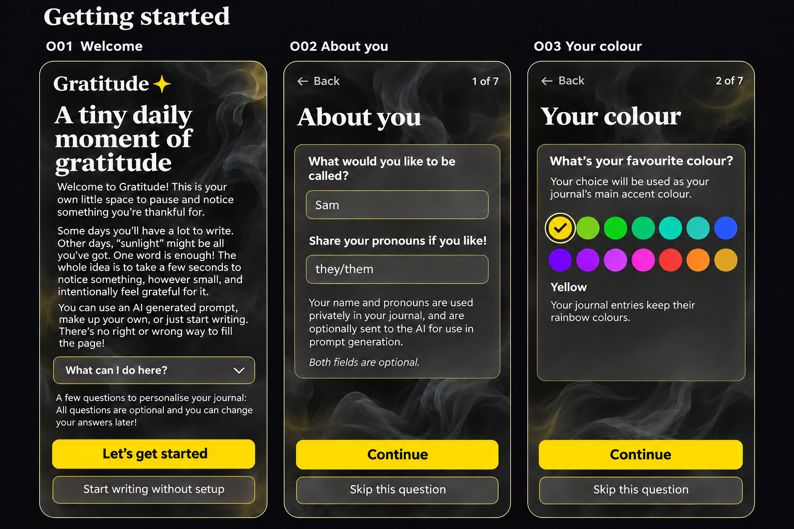
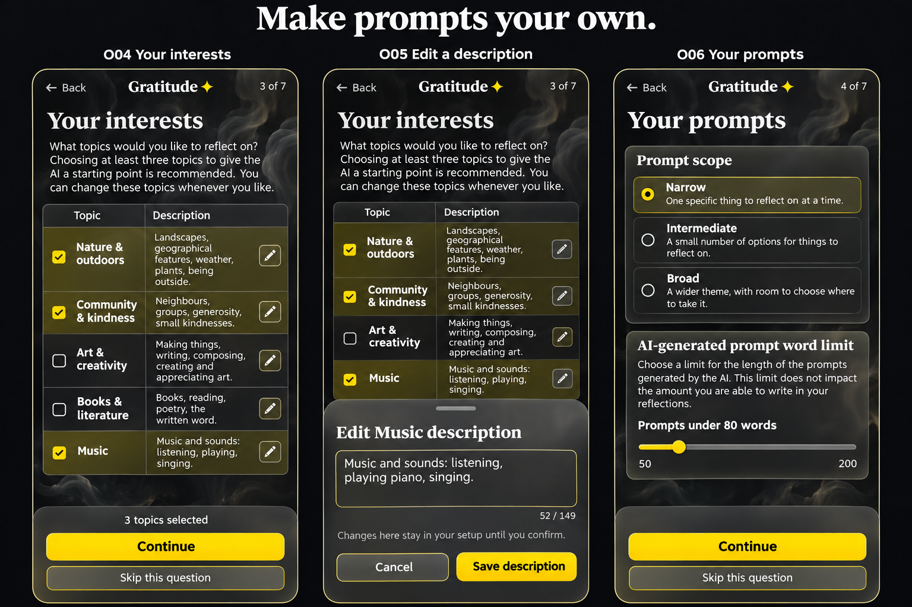
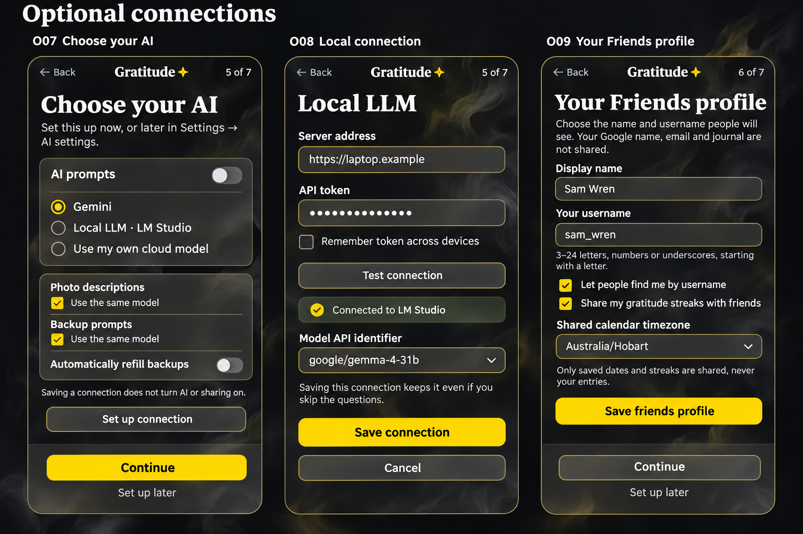
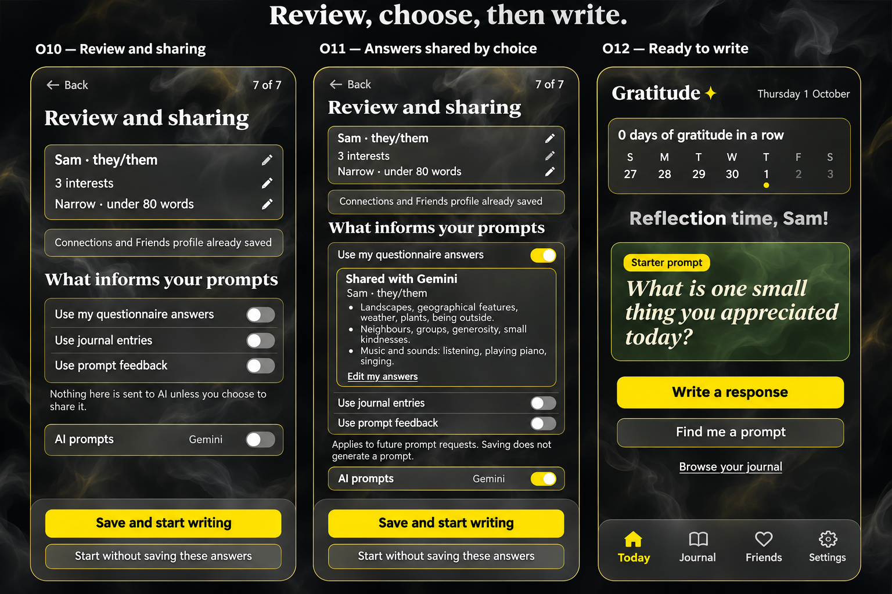
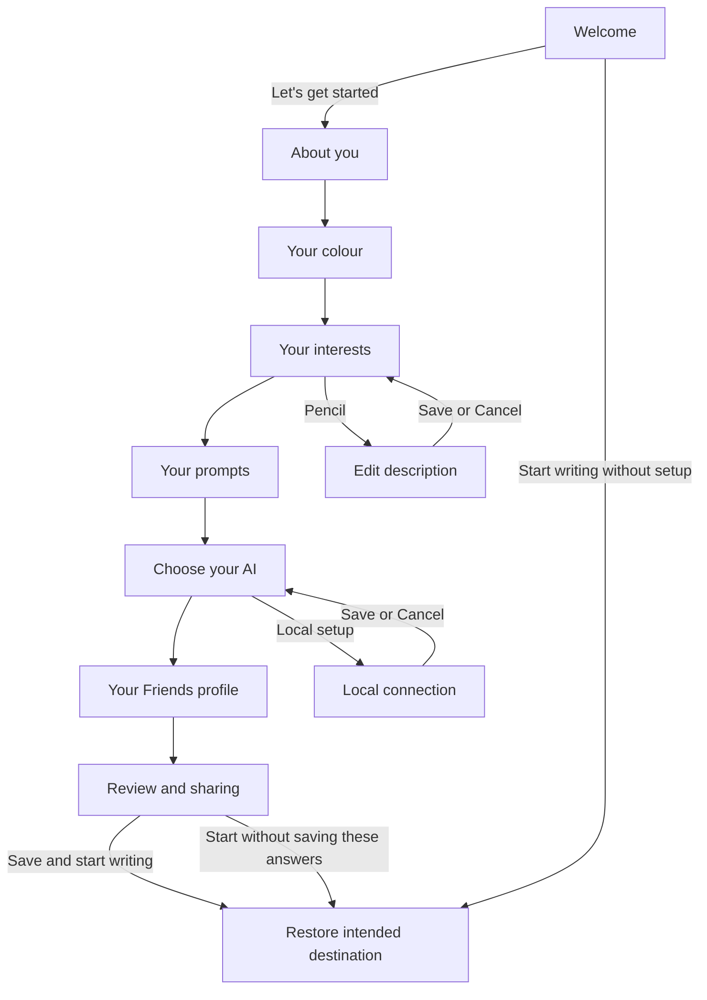

# Onboarding mockups for review

Four mobile design boards cover twelve screens and states for the [onboarding proposal](../../ONBOARDING_DESIGN.md). They use the dark glass, neutral ink lighting, yellow accent and four-point wordmark star from the current app. These are image-generated concepts, not implemented screens or E2E screenshots. The proposal defines exact copy, the complete topic catalogue and behaviour; the boards illustrate the layout.

The examples use fictional Sam, an explicitly entered public profile and a fictional local-model address. Selected answers illustrate choices the person has already made, not preselected questionnaire defaults. AI and its source-sharing choices start off for a new account; existing accounts keep their saved choices. Only the final Today screen has the normal four-tab navigation.

## 1. Welcome, identity and colour

[Open this board at full size](mockups/onboarding-review/01-welcome-identity-colour.png).

| Screen | What to review | Interaction |
| --- | --- | --- |
| O01 Welcome | Jamie’s introduction, with the feature list behind **What can I do here?** | **Let’s get started** opens O02. **Start writing without setup** acknowledges the rollout and restores the intended destination without saving questionnaire changes. Existing users receive the same welcome. |
| O02 About you · 1 of 7 | Optional private name and pronouns, distinct from public identity and AI permission. | Continue keeps these in the questionnaire draft; Skip discards this question’s unconfirmed edits. No Google name is inferred. |
| O03 Your colour · 2 of 7 | Fourteen account colours; yellow selected here. Entries keep their date rainbow. | Preview the selection without changing journal-card colours. Cancellation returns to the saved colour; a confirmed colour uses the existing Account save behaviour. |

The welcome is deliberately text-led. Its disclosure can expand into the complete feature list from the proposal; that expanded state is not pictured. Keep a scrollable content region above reachable actions rather than shrinking the supplied copy on shorter screens.

## 2. Interests and prompt style

[Open this board at full size](mockups/onboarding-review/02-interests-and-prompts.png).

| Screen | What to review | Interaction |
| --- | --- | --- |
| O04 Your interests · 3 of 7 | Topic, description and pencil controls in a wrapping mobile table. The example has three explicitly selected rows. | Tap a topic to select it; a checkmark accompanies its colour. Three is a recommendation, not a requirement. Continue also works with zero selections. |
| O05 Edit a description · 3 of 7 | An editor sheet keeps the topic context visible and shows the character limit. | The pencil opens this sheet. **Save description** updates the questionnaire draft without changing selection; Cancel restores the saved description. The illustrated edit is 52 characters, within the built-in maximum of 149. |
| O06 Your prompts · 4 of 7 | Narrow, Intermediate or Broad; a separate word-limit slider. | Narrow and under 80 words are the proposed defaults. The slider runs from 50 to 200 in steps of ten and changes prompt length, not reflection length. |

O04 shows only the first five of seventeen built-in rows. The remaining rows and repeatable **Other** label/description fields are below the fold, not removed from the design. Built-in descriptions must stay under 150 characters; custom descriptions allow up to 150. The rendered table behind the editor is illustrative, not an alternative ordering of the catalogue. The fictional Music edit in O05 is the description shown on O11.

## 3. Optional AI and Friends setup

[Open this board at full size](mockups/onboarding-review/03-ai-and-friends.png).

| Screen | What to review | Interaction |
| --- | --- | --- |
| O07 Choose your AI · 5 of 7 | Prompt provider, the same-model choices for photos/backups and independent refill control. | Configuration is optional. Choosing or saving a connection does not enable AI, sharing, automatic refill or a photo request. **Set up later** keeps existing choices and points to Settings → AI settings. |
| O08 Local connection · 5 of 7 detail | Address, token, optional account token storage, connection test and discovered-model picker. | Open after choosing local setup. **Save connection** is an explicit, separate save; Cancel returns to O07. This pictured connection uses a fictional address and placeholder token. |
| O09 Your Friends profile · 6 of 7 | A public name and username, discoverability, date/streak sharing and shared calendar timezone. | Reuse the existing Friends form. Its discoverability and streak-sharing defaults are checked, but nothing is published until **Save friends profile** succeeds. Continue must not silently save it. **Set up later** leaves an existing profile unchanged. |

The local connection and Gemini review are alternative provider examples, not a forced switch from local back to cloud. Use the actual selected provider in the review and its disclosure. **Use my own cloud model** represents the provider setup required by the proposal; that connection path must work before releasing onboarding that offers it.

Private name/pronouns never populate a public profile automatically. O09’s fictional public values were entered separately. Profile and connection saves remain saved if the person later skips the questionnaire; review makes that boundary visible. Photo processing still requires its own existing authorization, and selecting a backup model does not enable refilling.

## 4. Review, sharing and the first reflection

[Open this board at full size](mockups/onboarding-review/04-review-sharing-and-writing.png).

| Screen | What to review | Interaction |
| --- | --- | --- |
| O10 Review and sharing · 7 of 7 | Editable answers, already-saved setup and separate permission switches. | This new-account example has AI and all three source switches off. Saving private answers does not authorize AI to receive them. |
| O11 Answers shared by choice · 7 of 7 alternative | The expanded **Shared with Gemini** preview identifies exactly what questionnaire information will be used. | This state follows explicit AI/answers opt-in. Journal and feedback sharing stay off. Topic descriptions, including the edited Music description, are shown; labels alone are not the payload. **Edit my answers** returns to the questionnaire. |
| O12 Ready to write | The private **Reflection time, Sam!** heading and the existing Today layout. | Successful confirmation returns to the intended destination. Today is shown for an account without an entry for the local day. The starter prompt remains until the person explicitly requests AI or chooses another prompt. |

Saving does not generate a prompt. The pictured **Find me a prompt** action is the next explicit request in the AI-enabled example. Existing users with today’s entry return to Journal, and a manual visit from Settings returns to Settings; O12 is not a rule that every setup completion must open Today. Pronouns are not added to the heading.

## Flow and recovery

Back retains the questionnaire draft. Skip this question discards that question’s unconfirmed changes and moves forward; Set up later preserves existing AI/profile settings. Skipping the whole setup discards private draft answers and records the rollout outcome. Explicitly saved connections/profile remain saved. No new bottom tab is introduced for onboarding.

An unfinished visit resumes with its draft; existing users are interrupted once for this onboarding version, without losing journal drafts. A save error must keep entered answers and show Retry/Continue without setup, without claiming cloud confirmation. An offline completion stays account-scoped on the device until it can sync. These recovery states and the expanded welcome/custom-topic controls are specified in the proposal and are not additional rendered screens in this first review set.

## Review focus

- Welcome density and whether the disclosure keeps it approachable.
- The mobile topic table, row-editing sheet and reachability of the footer on short screens.
- How much optional provider/profile setup belongs in this initial flow.
- Whether the review makes private answers, AI sharing and already-saved public/connection settings distinct enough.

## Generation record

The [exact prompts and refinement record](prompts/onboarding-review/README.md) accompany all four PNGs. Built-in image generation was used; the selected images were copied unchanged into the repository. They are visual proposals, not screenshot baselines or evidence that onboarding works. Runtime implementation will require the functional and unmasked, zero-tolerance screenshot checks in [E2E_GUIDE.md](../../E2E_GUIDE.md).
