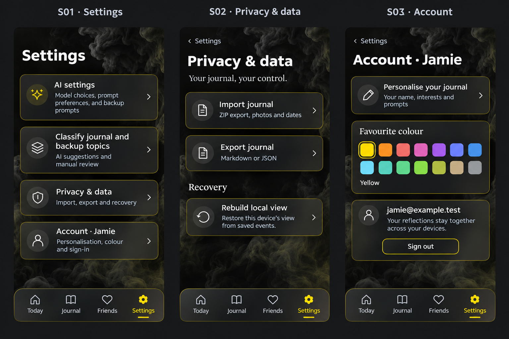
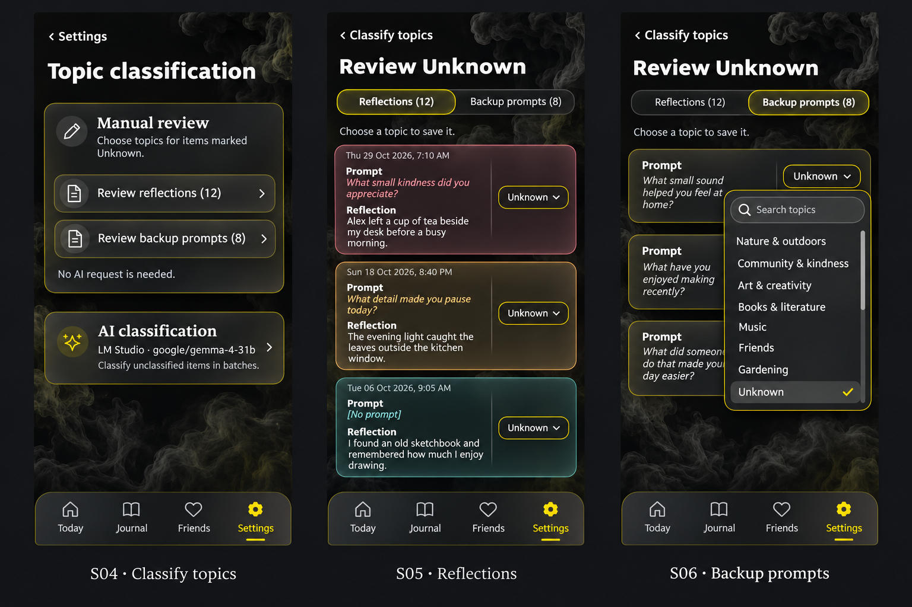
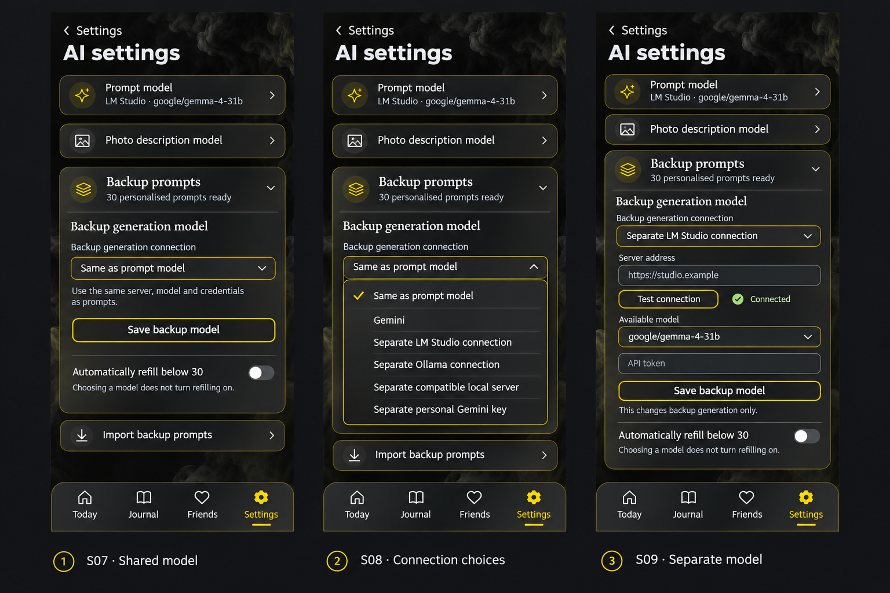

# Settings and Unknown review — proposal

Nine mobile concept screens for review, 17 November 2026. This PR contains designs only; the running app is unchanged. The examples, counts and account details are fictional. These generated mockups illustrate layout and interaction, not executable screenshots. The existing app's typography, colour picker and navigation components remain the implementation reference.

## Settings navigation

The root has four items, in this order:

| Item | Contents or destination |
| --- | --- |
| AI settings | Subtitle: **Model choices, prompt preferences, and backup prompts** |
| Classify journal and backup topics | Manual Unknown review and the existing consented AI classification tools |
| Privacy & data | Import journal, Export journal, and existing local-view recovery |
| Account · user | Personalise your journal, Favourite colour, account and sign-out |

Use the saved private preferred name after Account when supplied; otherwise show Account. Import and Export move off the root into Privacy & data. Personalise moves into Account; its existing AI-settings shortcut can remain. Child pages return to their actual parent: Import/Export to Privacy & data, Personalise to Account (or AI settings when opened there). Existing colour controls remain unchanged. The bottom tabs remain Today, Journal, Friends and Settings.

## Quick manual review

Path: **Settings → Classify journal and backup topics → Review reflections / Review backup prompts**. A Manual review card appears above the existing AI classification tools. Both links open Review Unknown with the corresponding filter selected. No additional root item or bottom tab is introduced.

Proposed behaviour:

- Include items whose current topic is **Unknown**. Keep **Not yet classified** distinct. Include a stale Unknown suggestion if its current text still needs review; do not sweep unrelated known or invalid suggestions into this queue.
- Reflection cards show their saved prompt, reflection and local entry datetime. Preserve `[No prompt]` on imported entries that have no prompt. Use the journal's date-derived card colours and Prompt/Reflection hierarchy. Backup cards show the saved question only, in neutral glass, without an invented reflection or entry date.
- Place the topic picker on the right of each compact card. Offer every built-in and custom topic, including topics not selected as interests, with search and the current selection marked. Keep Unknown selectable. Long text can expand with `(see more)` without leaving the review.
- Selecting a different topic saves the existing manual topic action inline, without an AI request. Keep the card in place for this review session, show the selected topic and a small Saved status, and decrease the remaining Unknown count. The user can immediately correct it. On a later visit, now-known items no longer enter the queue. Closing the picker without choosing changes nothing.
- Review available backup prompts, excluding consumed and removed ones. Merely viewing or selecting one for a draft does not make it consumed. A category change does not consume, remove or refill a backup, or alter its wording.
- Manual review changes the topic only. Preserve the prompt, reflection, date and availability. Reuse the existing manual-choice events; counts, session position and rendered cards are projections/UI state. Retain manual precedence over AI suggestions and do not silently overwrite an intervening edit from another device. Preserve a failed choice for explicit retry; show confirmed Saved only after acknowledgement.

Implementation should retain comfortable touch targets, keyboard navigation, accessible labels for each card's picker, and Escape/outside-click dismissal. The generated board is a compact mobile composition; long text, zoom and narrow screens must remain readable rather than enforcing its pictured heights.

## Backup generation model

Use the same connection-selection pattern as Photo description model:

1. Same as prompt model
2. Gemini
3. Separate LM Studio connection
4. Separate Ollama connection
5. Separate compatible local server
6. Separate personal Gemini key

**Same as prompt model** follows the prompt connection's server, model and credentials, including later changes. A separate choice can use the same provider on a different computer. Local connections test the server and expose discovered models in a dropdown. Backups are text generation; they do not require a vision model.

Saving the backup model affects backup generation only. Automatic refill remains a separate saved opt-in; choosing a connection does not enable it or change the prompt or photo model. Existing explicit backup choices must retain their effective provider, model, server and credentials during migration. Provider equality alone is not enough to infer a user's intent to follow the prompt model. The event/schema migration will be designed during implementation rather than implied by these images.

## Assets and validation

Generated with the built-in image-generation tool using the current [Settings screenshot](../../tests/e2e/006-reflection-editor/screenshots/027-settings-mobile-chromium.png) as a style reference. Exact generation prompts:

- [Settings navigation](prompts/settings-review/01-settings-navigation.txt)
- [Unknown review](prompts/settings-review/02-unknown-review.txt)
- [Backup model picker](prompts/settings-review/03-backup-model-picker.txt)

The three PNG boards are saved alongside this document under `mockups/settings-review/`. No app code, backend rules or executable screenshot baselines change in this proposal. Review approval precedes implementation and the corresponding step-by-step, unmasked, zero-pixel E2E walkthroughs.
