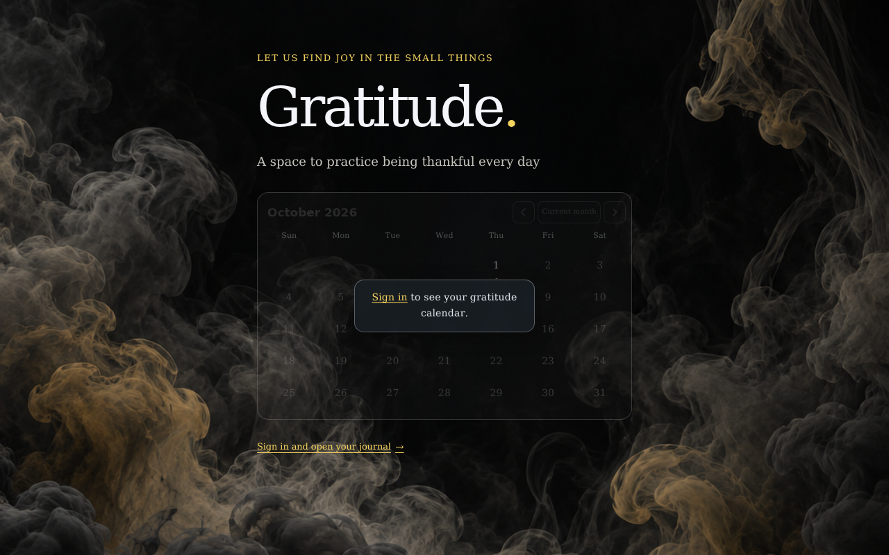
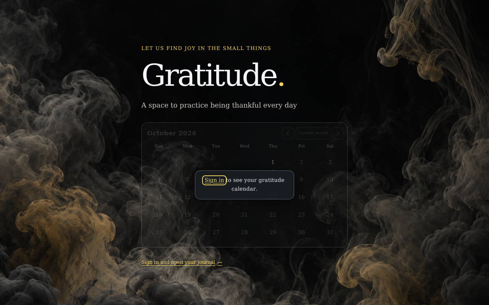
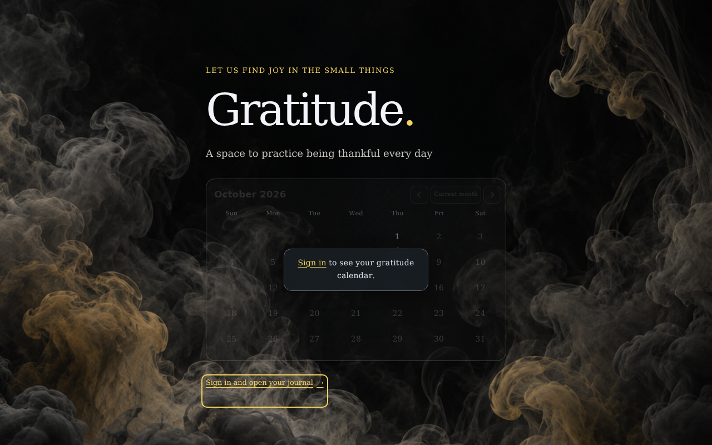

<!-- Generated by the E2E test. Do not edit by hand. -->

# The Gratitude landing page

A visitor opens the production build and sees an empty, disabled calendar under a sign-in overlay. Keyboard navigation skips calendar controls and reaches the sign-in links.

Viewport: desktop-chromium.

## A visitor can open Gratitude

**Verifications:**

- [x] The landing document returns HTTP 200
- [x] The page identifies itself as Gratitude
- [x] The install manifest preserves this deployment’s scope and transparent star-and-heart icons
- [x] Calendar account restoration finishes before the page is captured
- [x] The signed-out calendar is empty, greyed out and disabled, with its sign-in notice visible
- [x] The main heading is visible
- [x] Screenshot matches the committed baseline (zero differing pixels)

## Reach the sign-in link while skipping disabled calendar controls

**Verifications:**

- [x] The expected result of this action is visible
- [x] Screenshot matches the committed baseline (zero differing pixels)

## Reach the signed-out footer link

**Verifications:**

- [x] The expected result of this action is visible
- [x] Screenshot matches the committed baseline (zero differing pixels)
