<!-- Generated by the E2E test. Do not edit by hand. -->

# Recover an interrupted journal import

A raw source-event fixture represents a lost connection. Reload restores the private ZIP but never starts import automatically. Explicit resume rejects a corrupt stored photo, then completes after the deliberately corrupt emulator object is removed. Changed source records cannot overwrite saved writing. Full replay and reselect work without duplicate entries or AI. Every user action has an unmasked, full-page screenshot at zero pixel tolerance and checks below the image.

Viewport: desktop-chromium.

## Open Gratitude

**Verifications:**

- [x] The shared landing page shows its empty calendar and frosted sign-in notice
- [x] Screenshot matches the committed baseline (zero differing pixels)

## Choose Google sign-in

**Verifications:**

- [x] The Google emulator account chooser opens
- [x] Screenshot matches the committed baseline (zero differing pixels)

## Add a fictional Google account

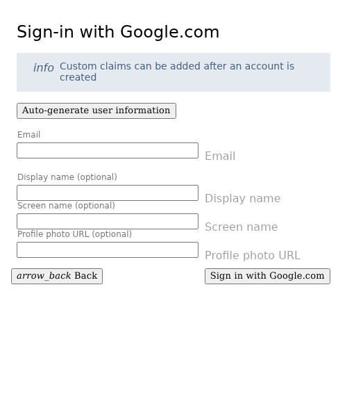

**Verifications:**

- [x] The account form opens
- [x] Screenshot matches the committed baseline (zero differing pixels)

## Enter the fictional email address

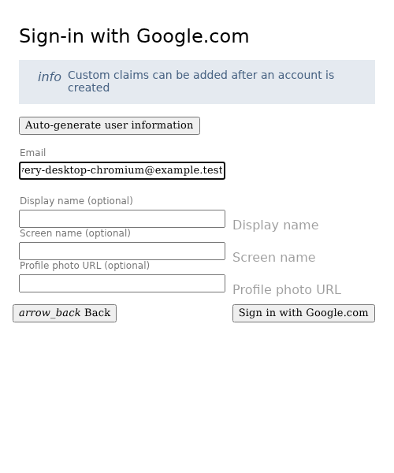

**Verifications:**

- [x] The email field retains the input
- [x] Screenshot matches the committed baseline (zero differing pixels)

## Enter a display name

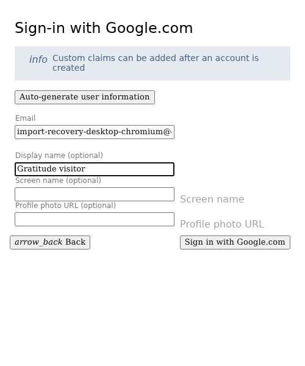

**Verifications:**

- [x] The display name is entered
- [x] Screenshot matches the committed baseline (zero differing pixels)

## Complete sign-in and open Today

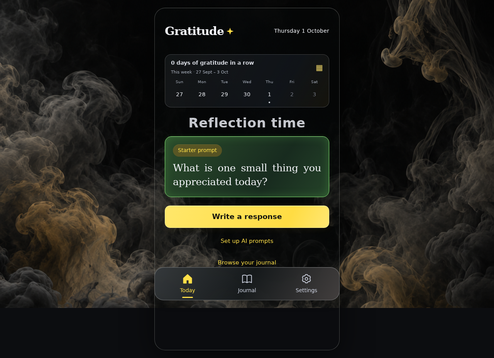

**Verifications:**

- [x] The private journal is synchronized and Today is ready
- [x] The bottom navigation retains its 24px backdrop blur in the production build
- [x] Screenshot matches the committed baseline (zero differing pixels)

## Open Settings

**Verifications:**

- [x] The expected result of this action is visible
- [x] Screenshot matches the committed baseline (zero differing pixels)

## Open the private journal importer

**Verifications:**

- [x] The expected result of this action is visible
- [x] Screenshot matches the committed baseline (zero differing pixels)

## Check the selected fictional ZIP before importing

**Verifications:**

- [x] The expected result of this action is visible
- [x] Screenshot matches the committed baseline (zero differing pixels)

## Recover a server-confirmed import without starting automatically

**Verifications:**

- [x] One pending record and two new records require explicit resume
- [x] Screenshot matches the committed baseline (zero differing pixels)

## Reload while the import is still unconfirmed

**Verifications:**

- [x] The expected result of this action is visible
- [x] Screenshot matches the committed baseline (zero differing pixels)

## Open Settings

**Verifications:**

- [x] The expected result of this action is visible
- [x] Screenshot matches the committed baseline (zero differing pixels)

## Open the private journal importer

**Verifications:**

- [x] The expected result of this action is visible
- [x] Screenshot matches the committed baseline (zero differing pixels)

## Recover the private ZIP selection on this device

**Verifications:**

- [x] The ZIP and pending receipt reopen, but no import runs on reload
- [x] Screenshot matches the committed baseline (zero differing pixels)

## Confirm this account before resuming

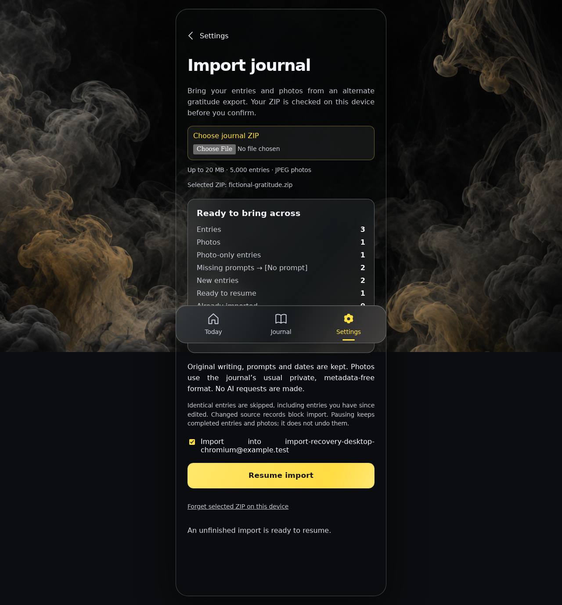

**Verifications:**

- [x] The expected result of this action is visible
- [x] Screenshot matches the committed baseline (zero differing pixels)

## Stop on a corrupt stored photo without overwriting it

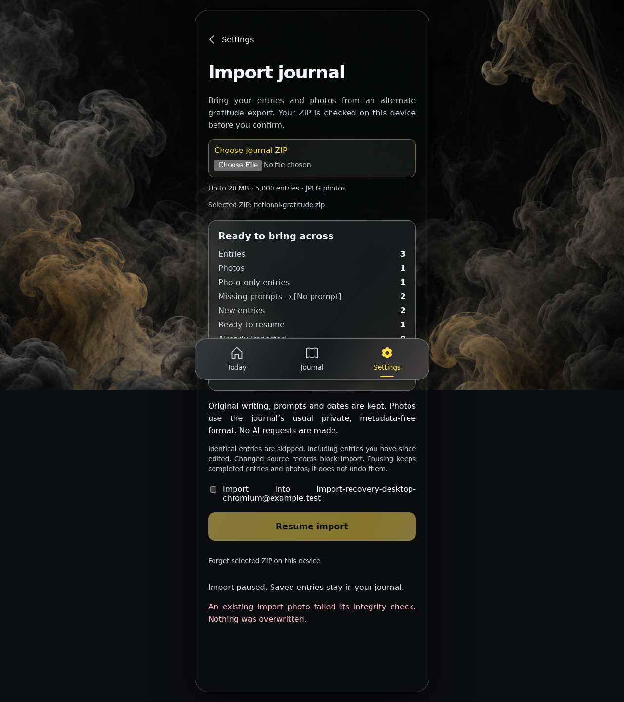

**Verifications:**

- [x] The expected result of this action is visible
- [x] Screenshot matches the committed baseline (zero differing pixels)

## Confirm a retry after the corrupt test object is removed

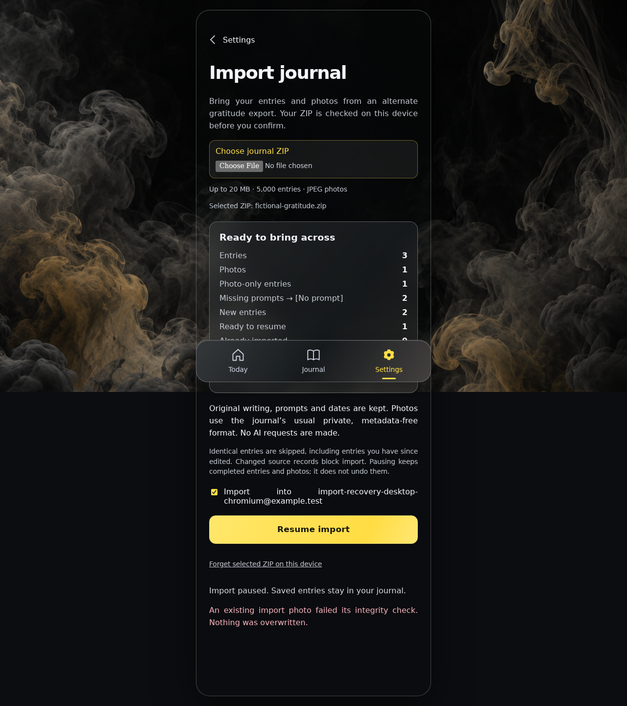

**Verifications:**

- [x] The expected result of this action is visible
- [x] Screenshot matches the committed baseline (zero differing pixels)

## Resume and show progress during a photo upload

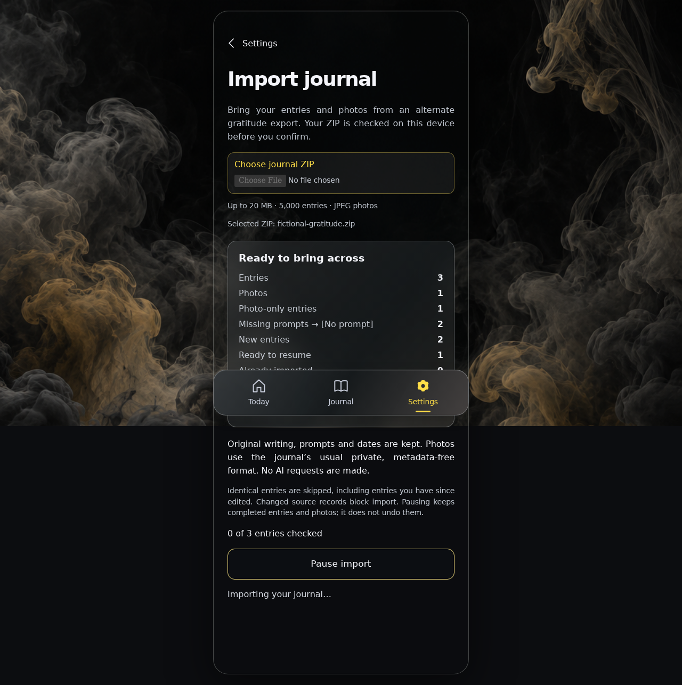

**Verifications:**

- [x] The expected result of this action is visible
- [x] Screenshot matches the committed baseline (zero differing pixels)

## Pause after the current upload operation

**Verifications:**

- [x] The expected result of this action is visible
- [x] Screenshot matches the committed baseline (zero differing pixels)

## Retain the pending receipt and uploaded photo for recovery

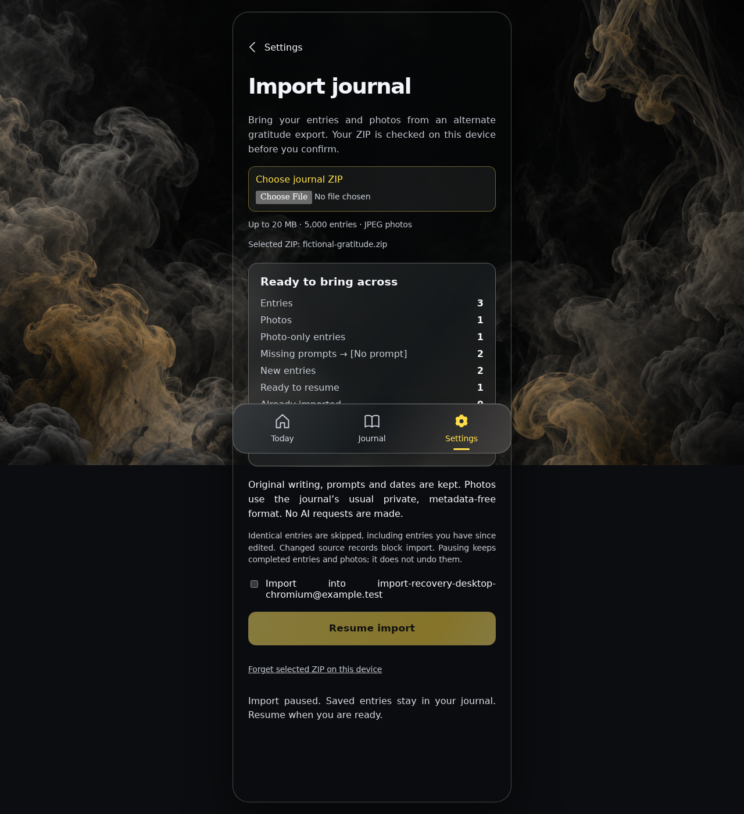

**Verifications:**

- [x] Import stops without completing the photo-only entry and requires renewed confirmation
- [x] Screenshot matches the committed baseline (zero differing pixels)

## Confirm continued import after pausing

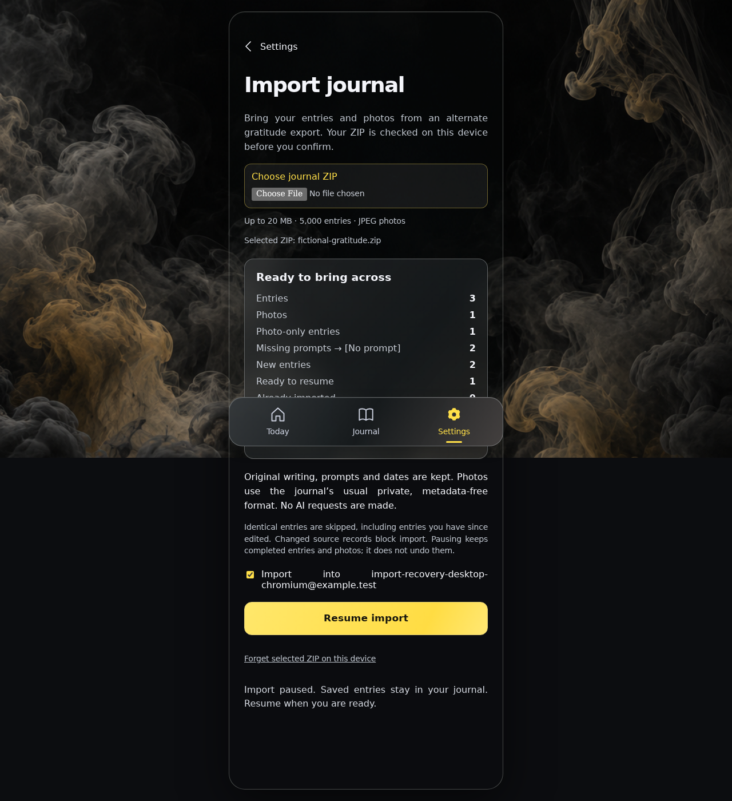

**Verifications:**

- [x] The expected result of this action is visible
- [x] Screenshot matches the committed baseline (zero differing pixels)

## Finish the same pending import without duplicate records

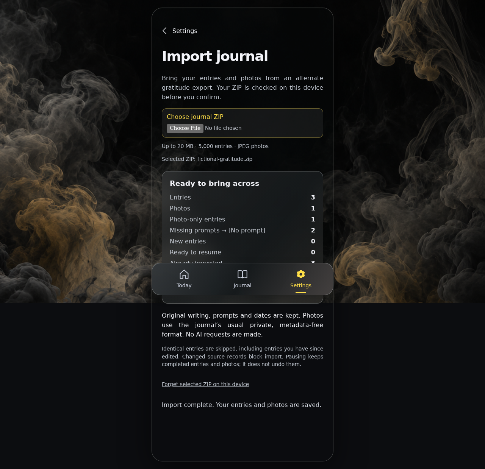

**Verifications:**

- [x] The expected result of this action is visible
- [x] Screenshot matches the committed baseline (zero differing pixels)

## Reject changed source input under an existing source identity

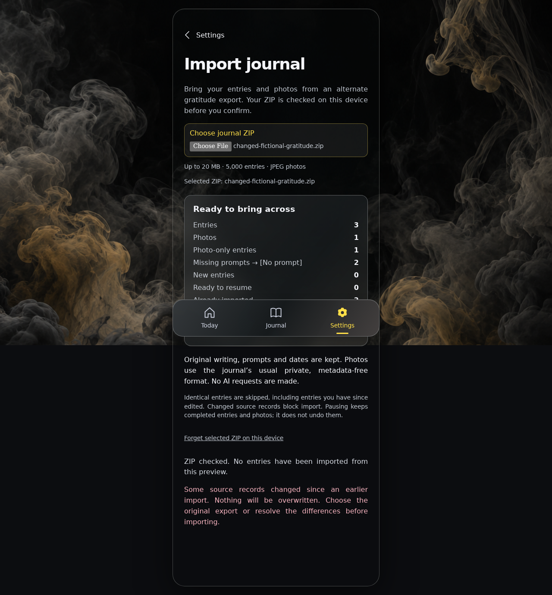

**Verifications:**

- [x] The expected result of this action is visible
- [x] Screenshot matches the committed baseline (zero differing pixels)

## Forget this device’s ZIP selection without deleting saved entries

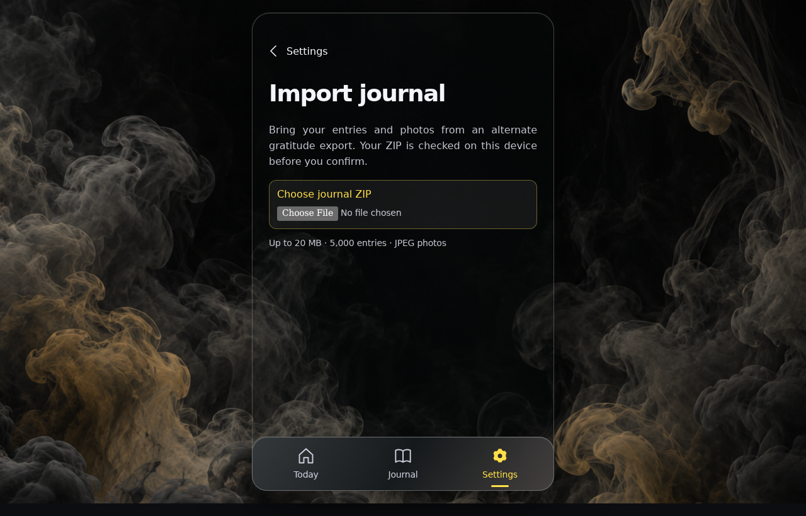

**Verifications:**

- [x] The expected result of this action is visible
- [x] Screenshot matches the committed baseline (zero differing pixels)

## Open Settings

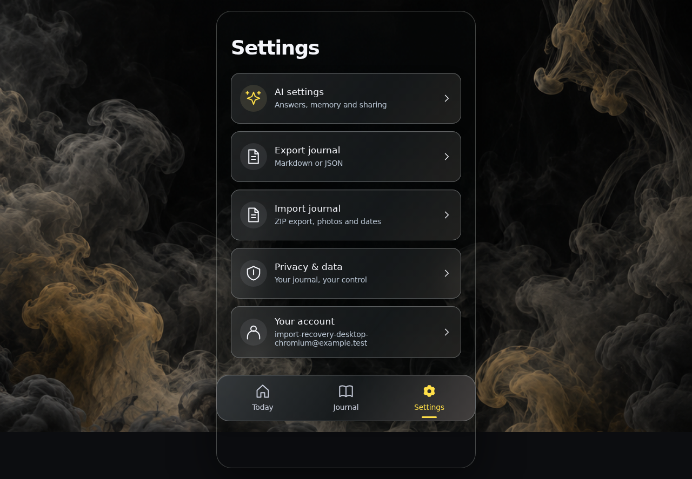

**Verifications:**

- [x] The expected result of this action is visible
- [x] Screenshot matches the committed baseline (zero differing pixels)

## Open journal recovery

**Verifications:**

- [x] The expected result of this action is visible
- [x] Screenshot matches the committed baseline (zero differing pixels)

## Replay import receipts and entries without the ZIP or AI

**Verifications:**

- [x] The expected result of this action is visible
- [x] Screenshot matches the committed baseline (zero differing pixels)

## Read all imported entries after complete replay

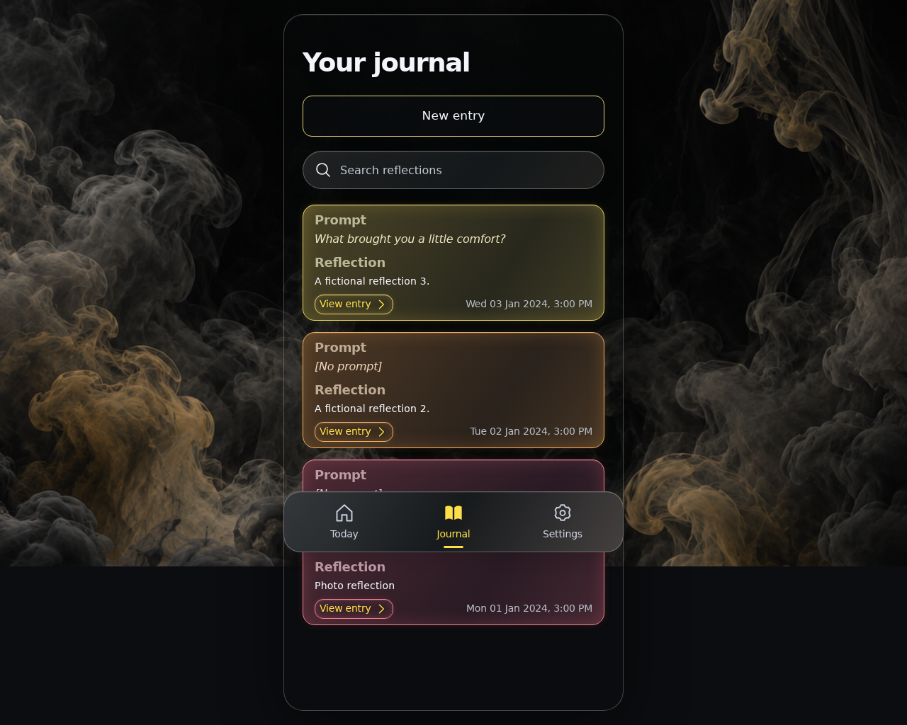

**Verifications:**

- [x] The expected result of this action is visible
- [x] Screenshot matches the committed baseline (zero differing pixels)

## Open Settings

**Verifications:**

- [x] The expected result of this action is visible
- [x] Screenshot matches the committed baseline (zero differing pixels)

## Open the private journal importer

**Verifications:**

- [x] The expected result of this action is visible
- [x] Screenshot matches the committed baseline (zero differing pixels)

## Keep the source ZIP off this device after forgetting it

**Verifications:**

- [x] Saved entries remain, but local archive recovery has been cleared
- [x] Screenshot matches the committed baseline (zero differing pixels)

## Check the selected fictional ZIP before importing

**Verifications:**

- [x] The expected result of this action is visible
- [x] Screenshot matches the committed baseline (zero differing pixels)

## Recognize completed imports using the server history

**Verifications:**

- [x] Reselecting the original ZIP shows three completed entries and no writes to resume
- [x] Screenshot matches the committed baseline (zero differing pixels)
