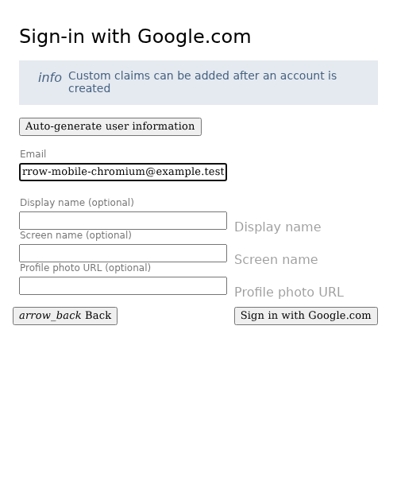
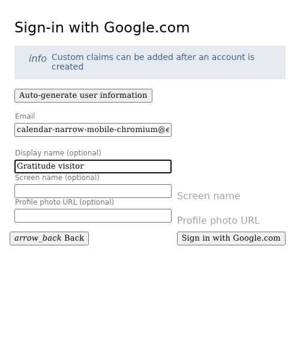
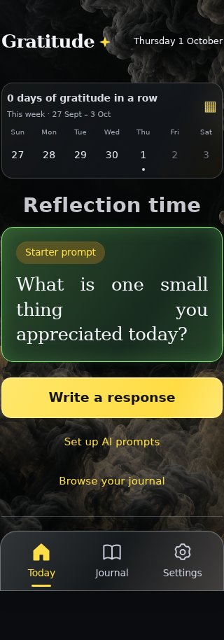
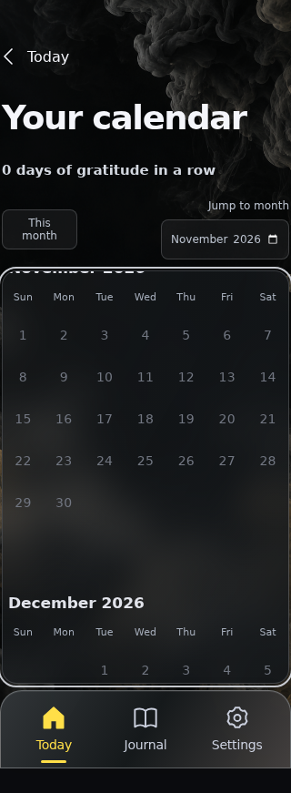
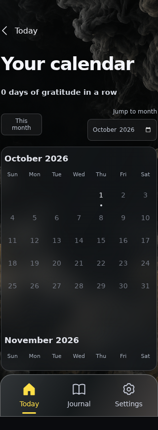
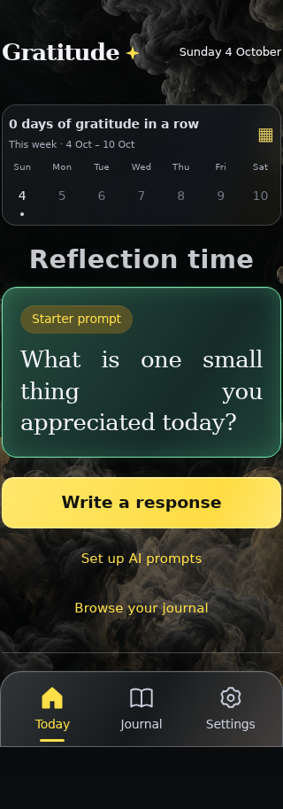

<!-- Generated by the E2E test. Do not edit by hand. -->

# Narrow-screen calendar and keyboard access

The real product layout fits 320px without horizontal overflow, retains 44px week-day targets and supports focusable keyboard month scrolling. Future dates remain disabled. Every action has a full-page unmasked zero-pixel screenshot with checks underneath.

Viewport: mobile-chromium.

## Open Gratitude

**Verifications:**

- [x] The shared landing page shows its empty calendar and frosted sign-in notice
- [x] Screenshot matches the committed baseline (zero differing pixels)

## Choose Google sign-in

**Verifications:**

- [x] The Google emulator account chooser opens
- [x] Screenshot matches the committed baseline (zero differing pixels)

## Add a fictional Google account

**Verifications:**

- [x] The account form opens
- [x] Screenshot matches the committed baseline (zero differing pixels)

## Enter the fictional email address

**Verifications:**

- [x] The email field retains the input
- [x] Screenshot matches the committed baseline (zero differing pixels)

## Enter a display name

**Verifications:**

- [x] The display name is entered
- [x] Screenshot matches the committed baseline (zero differing pixels)

## Complete sign-in and open Today

**Verifications:**

- [x] The private journal is synchronized and Today is ready
- [x] The bottom navigation retains its 24px backdrop blur in the production build
- [x] Screenshot matches the committed baseline (zero differing pixels)

## Use a 320-pixel mobile screen

**Verifications:**

- [x] The expected result of this action is visible
- [x] Screenshot matches the committed baseline (zero differing pixels)

## Open the scrolling calendar on the narrow screen

**Verifications:**

- [x] The expected result of this action is visible
- [x] Screenshot matches the committed baseline (zero differing pixels)

## Focus the calendar scroll region with its accessible label

**Verifications:**

- [x] The expected result of this action is visible
- [x] Screenshot matches the committed baseline (zero differing pixels)

## Scroll to later months using the keyboard

**Verifications:**

- [x] The expected result of this action is visible
- [x] Screenshot matches the committed baseline (zero differing pixels)

## Return to the current month

**Verifications:**

- [x] The expected result of this action is visible
- [x] Screenshot matches the committed baseline (zero differing pixels)

## Return to the same Today page

**Verifications:**

- [x] The expected result of this action is visible
- [x] Screenshot matches the committed baseline (zero differing pixels)

## Roll into the new Sunday-first week without a saved event

**Verifications:**

- [x] The foreground date change updates the header, current week and disabled future days
- [x] Screenshot matches the committed baseline (zero differing pixels)
