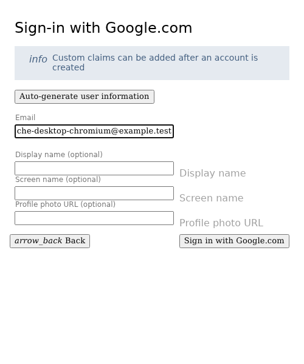
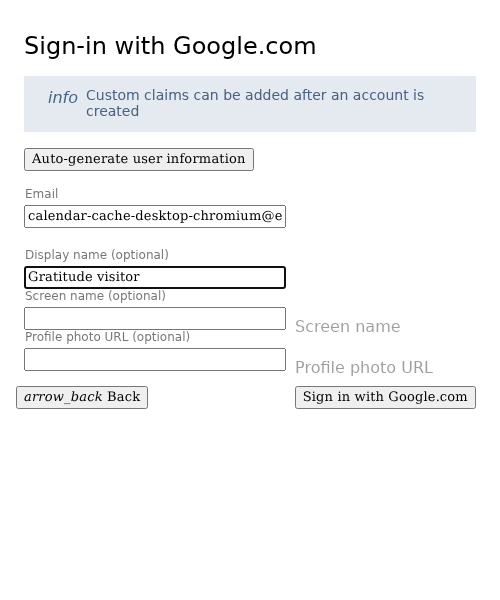
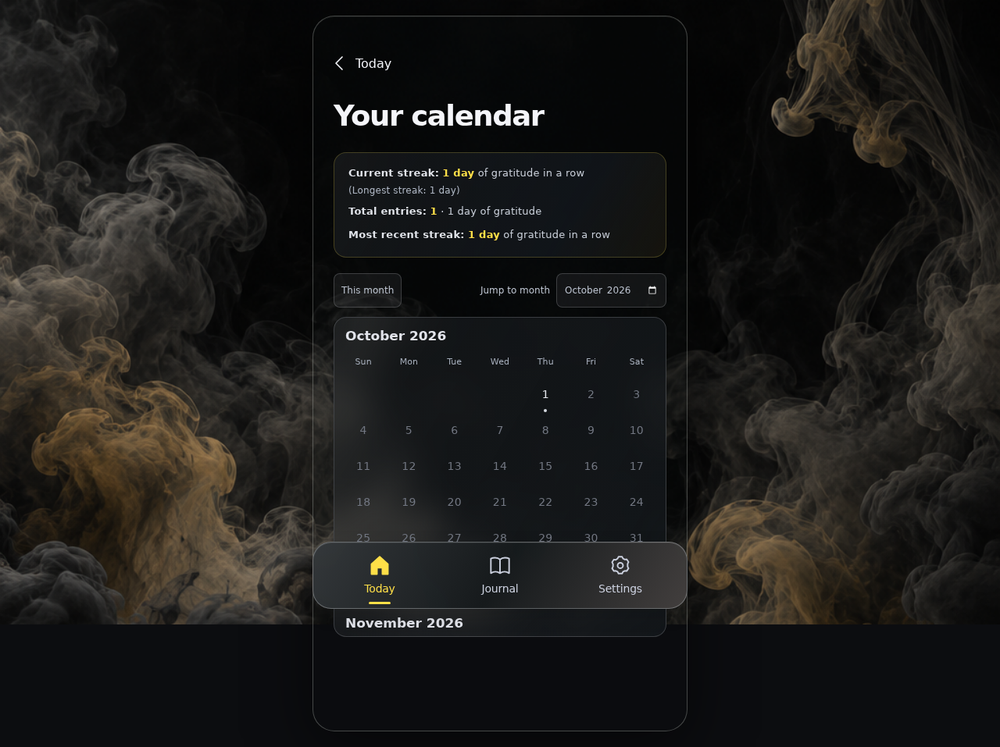
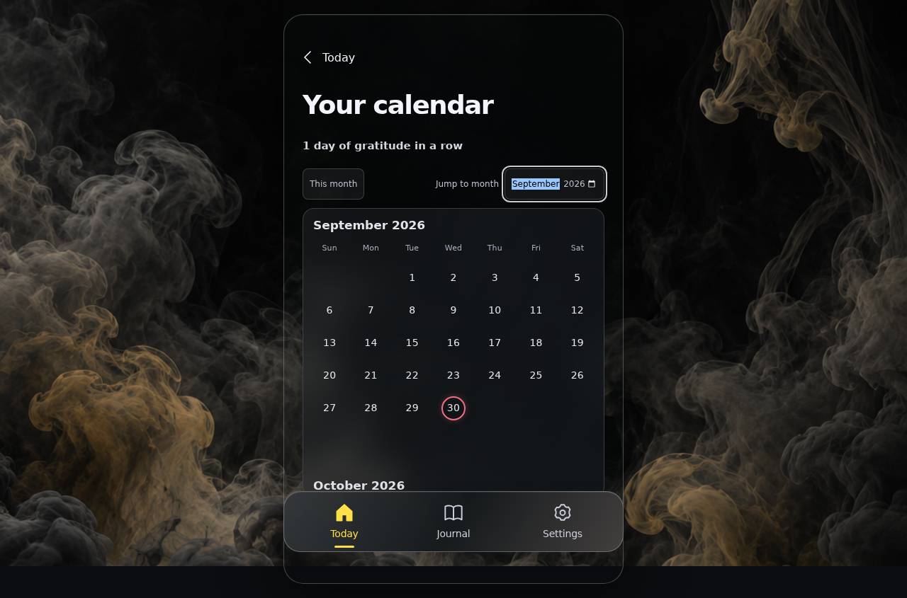
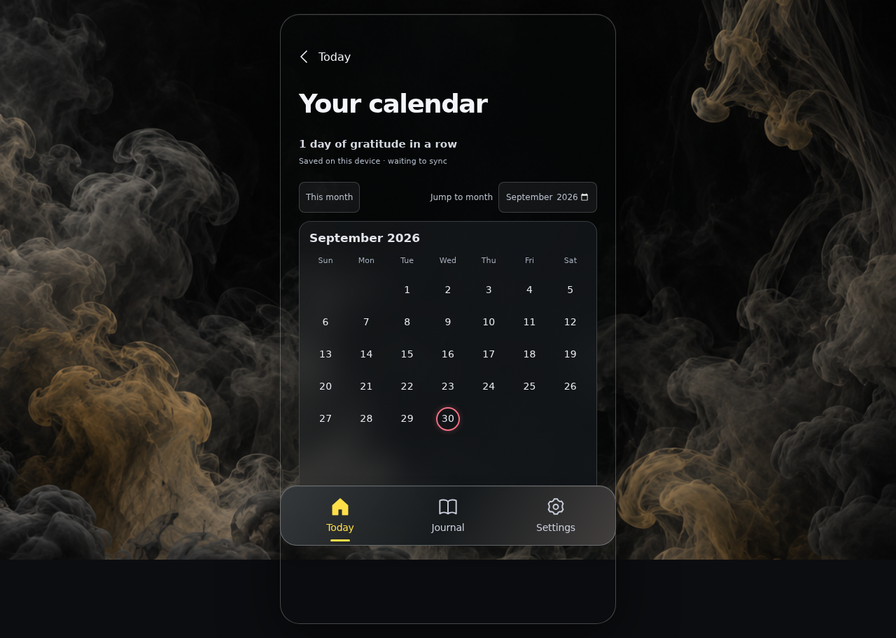
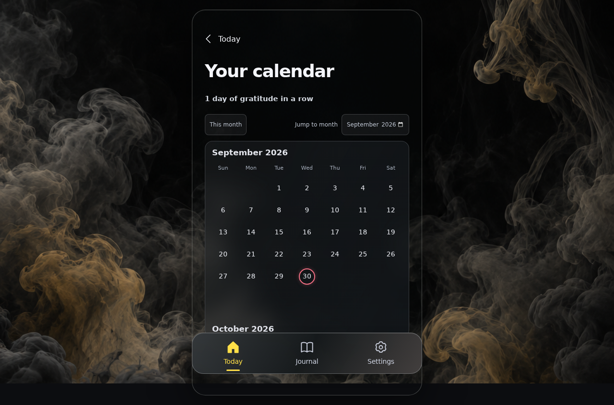

<!-- Generated by the E2E test. Do not edit by hand. -->

# Cached calendar during a backend outage

A digest-checked local prefix remains visible when Firestore is unavailable. Reconnection verifies its immutable anchor before accepting a server tail. HTML and authentication stay available; offline cold starts are outside this contract. Every user action has an unmasked zero-pixel screenshot with checks underneath.

Viewport: desktop-chromium.

## Open Gratitude

**Verifications:**

- [x] The shared landing page shows its empty calendar and frosted sign-in notice
- [x] Screenshot matches the committed baseline (zero differing pixels)

## Choose Google sign-in

**Verifications:**

- [x] The Google emulator account chooser opens
- [x] Screenshot matches the committed baseline (zero differing pixels)

## Add a fictional Google account

**Verifications:**

- [x] The account form opens
- [x] Screenshot matches the committed baseline (zero differing pixels)

## Enter the fictional email address

**Verifications:**

- [x] The email field retains the input
- [x] Screenshot matches the committed baseline (zero differing pixels)

## Enter a display name

**Verifications:**

- [x] The display name is entered
- [x] Screenshot matches the committed baseline (zero differing pixels)

## Complete sign-in and open Today

**Verifications:**

- [x] The private journal is synchronized and Today is ready
- [x] The bottom navigation retains its 24px backdrop blur in the production build
- [x] Screenshot matches the committed baseline (zero differing pixels)

## Open the synchronized calendar

**Verifications:**

- [x] The expected result of this action is visible
- [x] Screenshot matches the committed baseline (zero differing pixels)

## Choose the historical month to preserve

**Verifications:**

- [x] The expected result of this action is visible
- [x] Screenshot matches the committed baseline (zero differing pixels)

## Reload during a backend outage without discarding the cached prefix

**Verifications:**

- [x] The expected result of this action is visible
- [x] Screenshot matches the committed baseline (zero differing pixels)

## Revalidate the saved prefix when Firestore returns

**Verifications:**

- [x] Synchronization retains the same historical month and saved date
- [x] Screenshot matches the committed baseline (zero differing pixels)
