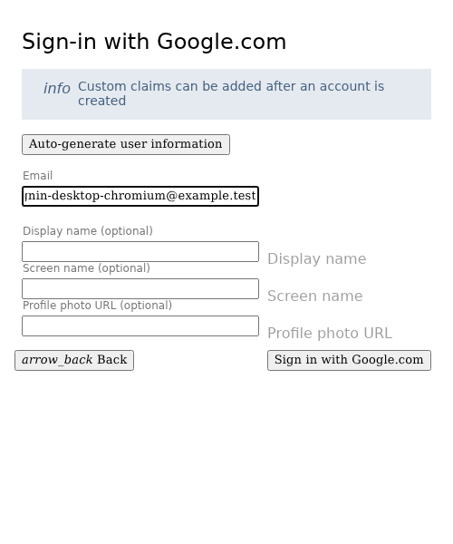
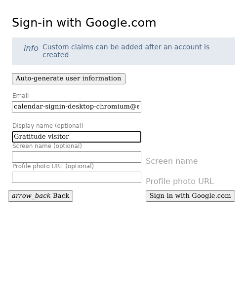
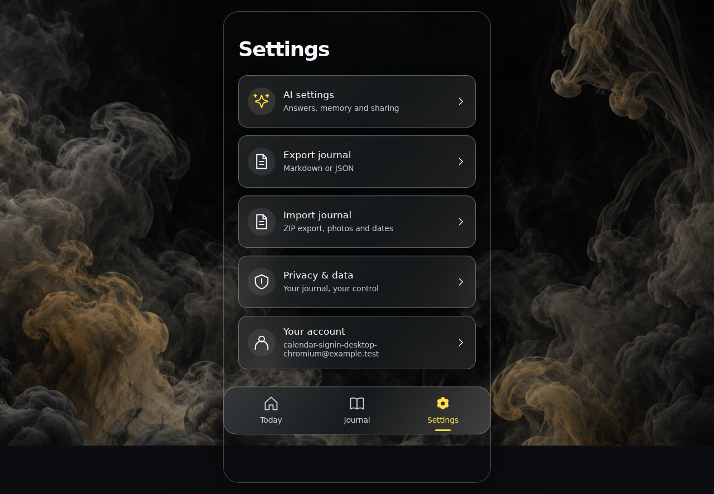
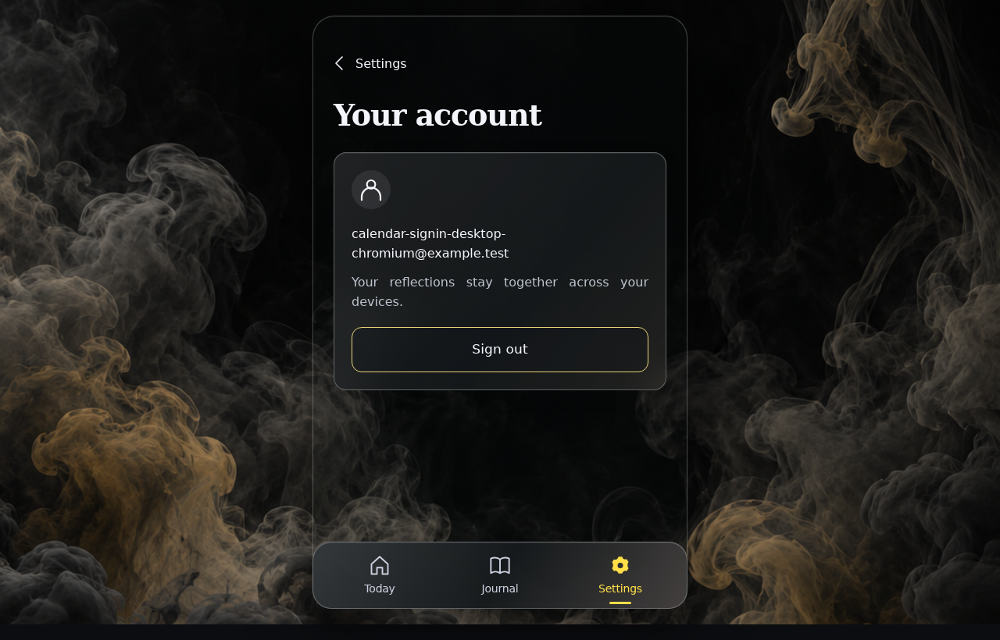
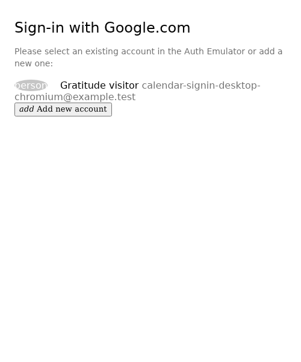
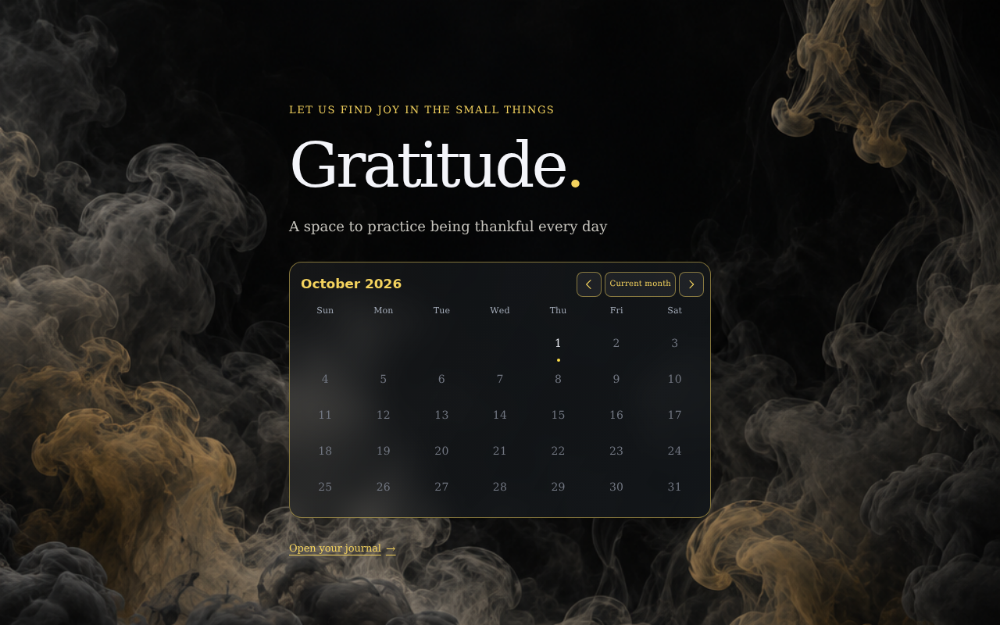

<!-- Generated by the E2E test. Do not edit by hand. -->

# Sign in from the calendar preview

The signed-out landing calendar is empty and disabled under its sign-in notice. Both the overlay link and signed-out footer open Google authentication and then Journal. Signed-in users retain the ordinary footer and interactive calendar. Every action has an unmasked full-page screenshot at zero pixel tolerance, with checks below the image.

Viewport: desktop-chromium.

## Open the signed-out calendar preview

**Verifications:**

- [x] The expected result of this action is visible
- [x] Screenshot matches the committed baseline (zero differing pixels)

## Choose Google sign-in

**Verifications:**

- [x] The Google emulator account chooser opens
- [x] Screenshot matches the committed baseline (zero differing pixels)

## Add a fictional Google account

**Verifications:**

- [x] The account form opens
- [x] Screenshot matches the committed baseline (zero differing pixels)

## Enter the fictional email address

**Verifications:**

- [x] The email field retains the input
- [x] Screenshot matches the committed baseline (zero differing pixels)

## Enter a display name

**Verifications:**

- [x] The display name is entered
- [x] Screenshot matches the committed baseline (zero differing pixels)

## Open Journal after sign-in from the landing page

**Verifications:**

- [x] The landing sign-in link opens the synchronized Journal
- [x] The bottom navigation retains its 24px backdrop blur in the production build
- [x] Screenshot matches the committed baseline (zero differing pixels)

## Complete sign-in directly into Journal even with no saved entries

**Verifications:**

- [x] The explicit landing-link destination is consumed and the journal is ready
- [x] Screenshot matches the committed baseline (zero differing pixels)

## Open Settings

**Verifications:**

- [x] The expected result of this action is visible
- [x] Screenshot matches the committed baseline (zero differing pixels)

## Open the signed-in account

**Verifications:**

- [x] The expected result of this action is visible
- [x] Screenshot matches the committed baseline (zero differing pixels)

## Sign out before checking the footer entry point

**Verifications:**

- [x] The expected result of this action is visible
- [x] Screenshot matches the committed baseline (zero differing pixels)

## Return to the signed-out landing page

**Verifications:**

- [x] The expected result of this action is visible
- [x] Screenshot matches the committed baseline (zero differing pixels)

## Choose Google sign-in

**Verifications:**

- [x] The Google emulator account chooser opens
- [x] Screenshot matches the committed baseline (zero differing pixels)

## Open Journal after sign-in from the landing page

**Verifications:**

- [x] The landing sign-in link opens the synchronized Journal
- [x] The bottom navigation retains its 24px backdrop blur in the production build
- [x] Screenshot matches the committed baseline (zero differing pixels)

## Open Today after signing in

**Verifications:**

- [x] The expected result of this action is visible
- [x] Screenshot matches the committed baseline (zero differing pixels)

## Keep the ordinary footer and interactive calendar after sign-in

**Verifications:**

- [x] The expected result of this action is visible
- [x] Screenshot matches the committed baseline (zero differing pixels)
