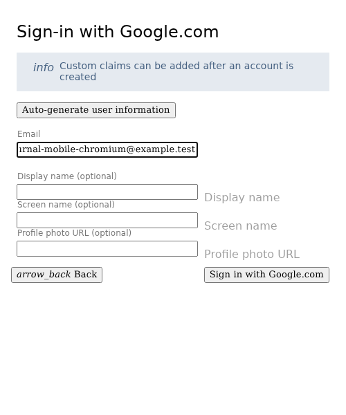
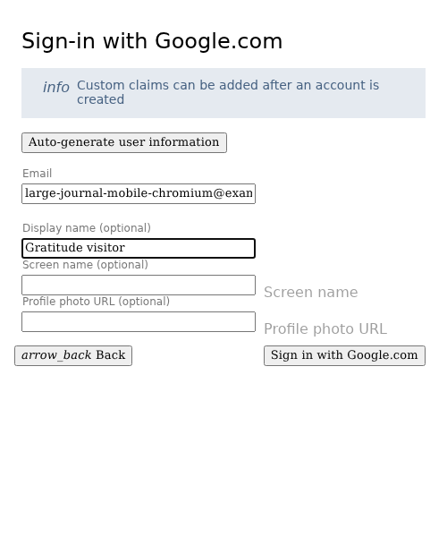
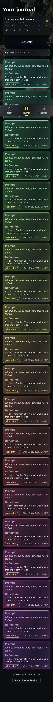
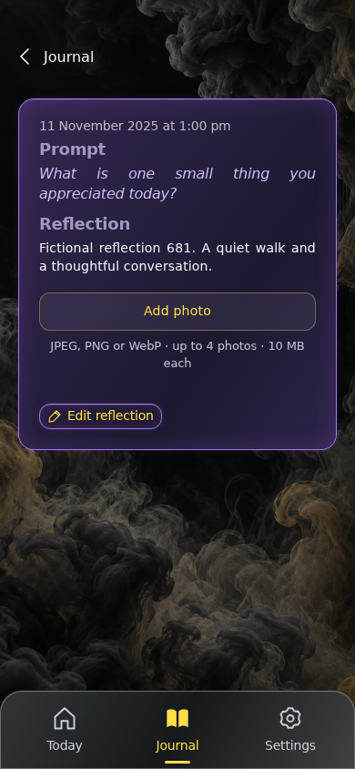
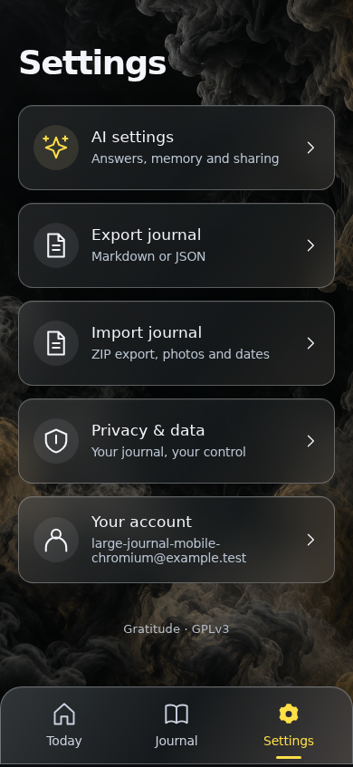
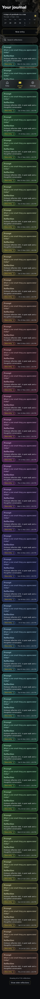
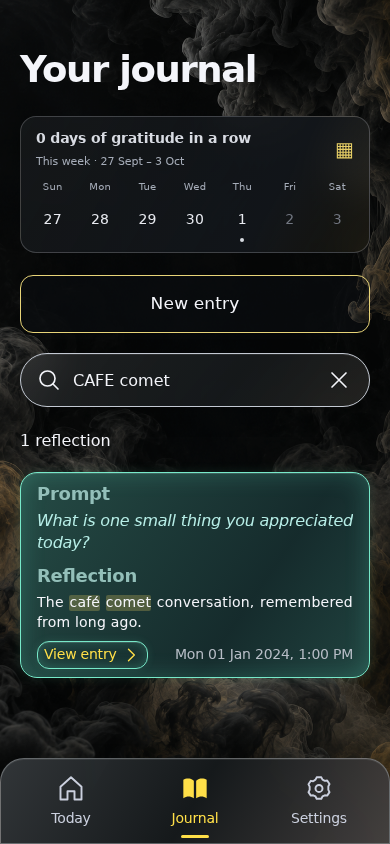
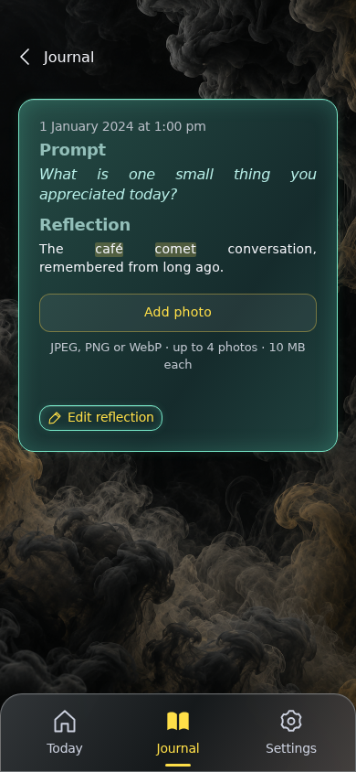
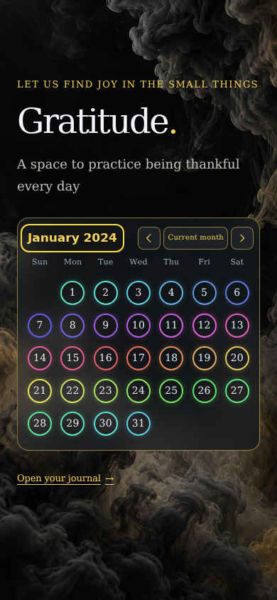

<!-- Generated by the E2E test. Do not edit by hand. -->

# Responsive navigation through 701 reflections

Fictional raw events create a large journal. Twenty cards mount initially; scrolling adds twenty. Search covers the full history, entry navigation retains the loaded range, Settings stays independent, and a cached reload restores every entry. Timing observations are attached to the test report without hardware-dependent pass/fail limits. Every user action has an unmasked full-page screenshot comparison with zero pixel tolerance.

Viewport: mobile-chromium.

## Open Gratitude

**Verifications:**

- [x] The shared landing page shows its empty calendar and frosted sign-in notice
- [x] Screenshot matches the committed baseline (zero differing pixels)

## Choose Google sign-in

**Verifications:**

- [x] The Google emulator account chooser opens
- [x] Screenshot matches the committed baseline (zero differing pixels)

## Add a fictional Google account

**Verifications:**

- [x] The account form opens
- [x] Screenshot matches the committed baseline (zero differing pixels)

## Enter the fictional email address

**Verifications:**

- [x] The email field retains the input
- [x] Screenshot matches the committed baseline (zero differing pixels)

## Enter a display name

**Verifications:**

- [x] The display name is entered
- [x] Screenshot matches the committed baseline (zero differing pixels)

## Complete sign-in and open Today

**Verifications:**

- [x] The private journal is synchronized and Today is ready
- [x] The bottom navigation retains its 24px backdrop blur in the production build
- [x] Screenshot matches the committed baseline (zero differing pixels)

## Open a journal with 701 saved reflections

**Verifications:**

- [x] Only the newest twenty cards are mounted; all 701 entries remain available
- [x] Screenshot matches the committed baseline (zero differing pixels)

## Scroll down to automatically load older reflections

**Verifications:**

- [x] Scrolling loads twenty more cards without a button click
- [x] Screenshot matches the committed baseline (zero differing pixels)

## Open an entry from the second batch

**Verifications:**

- [x] The expected result of this action is visible
- [x] Screenshot matches the committed baseline (zero differing pixels)

## Return to the loaded journal range

**Verifications:**

- [x] Returning preserves the loaded cards and focuses the entry that was opened
- [x] Screenshot matches the committed baseline (zero differing pixels)

## Open Settings from a large journal

**Verifications:**

- [x] Settings replaces the journal without mounting or measuring hidden cards
- [x] Screenshot matches the committed baseline (zero differing pixels)

## Open model and prompt settings

**Verifications:**

- [x] The expected result of this action is visible
- [x] Screenshot matches the committed baseline (zero differing pixels)

## Return to the settings menu

**Verifications:**

- [x] The expected result of this action is visible
- [x] Screenshot matches the committed baseline (zero differing pixels)

## Return to the journal after Settings

**Verifications:**

- [x] The expected result of this action is visible
- [x] Screenshot matches the committed baseline (zero differing pixels)

## Search the complete history for an unmounted entry

**Verifications:**

- [x] Accent-insensitive search includes the oldest entry, beyond the rendered batches
- [x] Screenshot matches the committed baseline (zero differing pixels)

## Read the matching historical reflection

**Verifications:**

- [x] The expected result of this action is visible
- [x] Screenshot matches the committed baseline (zero differing pixels)

## Return to the retained search

**Verifications:**

- [x] The expected result of this action is visible
- [x] Screenshot matches the committed baseline (zero differing pixels)

## Restore the previously loaded journal range

**Verifications:**

- [x] The expected result of this action is visible
- [x] Screenshot matches the committed baseline (zero differing pixels)

## Return to Today without rendering historical cards

**Verifications:**

- [x] The expected result of this action is visible
- [x] Screenshot matches the committed baseline (zero differing pixels)

## Restore the large journal from its cached projection

**Verifications:**

- [x] The expected result of this action is visible
- [x] Screenshot matches the committed baseline (zero differing pixels)

## Open a fresh twenty-card range after reload

**Verifications:**

- [x] The expected result of this action is visible
- [x] Screenshot matches the committed baseline (zero differing pixels)

## Return to Today before opening the landing calendar

**Verifications:**

- [x] The expected result of this action is visible
- [x] Screenshot matches the committed baseline (zero differing pixels)

## Open the landing page from Today with a large history

**Verifications:**

- [x] The existing signed-in projection supplies one month of date buttons
- [x] Screenshot matches the committed baseline (zero differing pixels)

## Choose a historical month without reloading the journal

**Verifications:**

- [x] The expected result of this action is visible
- [x] Screenshot matches the committed baseline (zero differing pixels)

## Enter January

**Verifications:**

- [x] The expected result of this action is visible
- [x] Screenshot matches the committed baseline (zero differing pixels)

## Enter the year of the earliest saved reflections

**Verifications:**

- [x] The expected result of this action is visible
- [x] Screenshot matches the committed baseline (zero differing pixels)

## Show the saved rings from the complete historical projection

**Verifications:**

- [x] The expected result of this action is visible
- [x] Screenshot matches the committed baseline (zero differing pixels)
