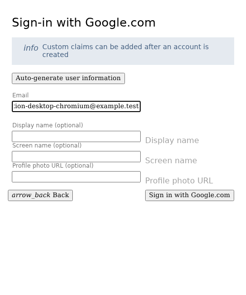
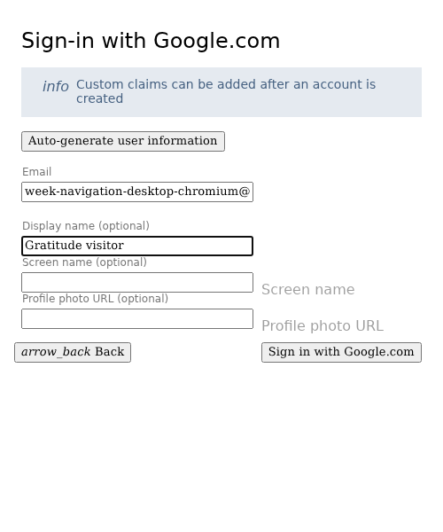
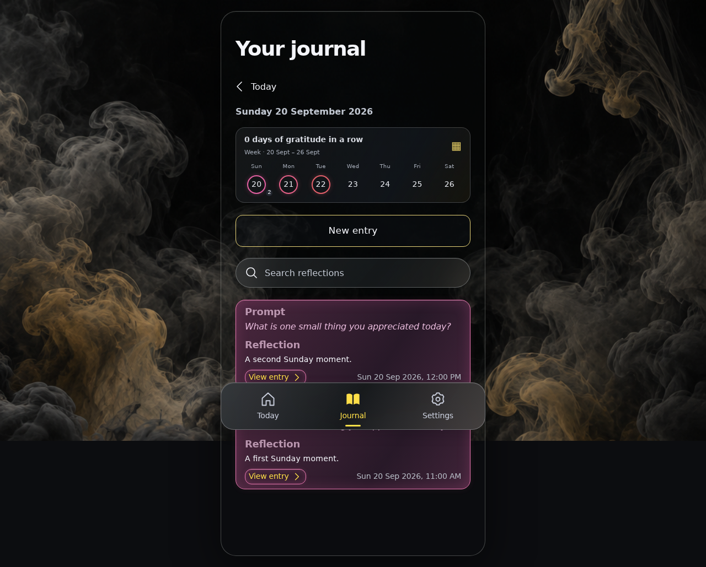
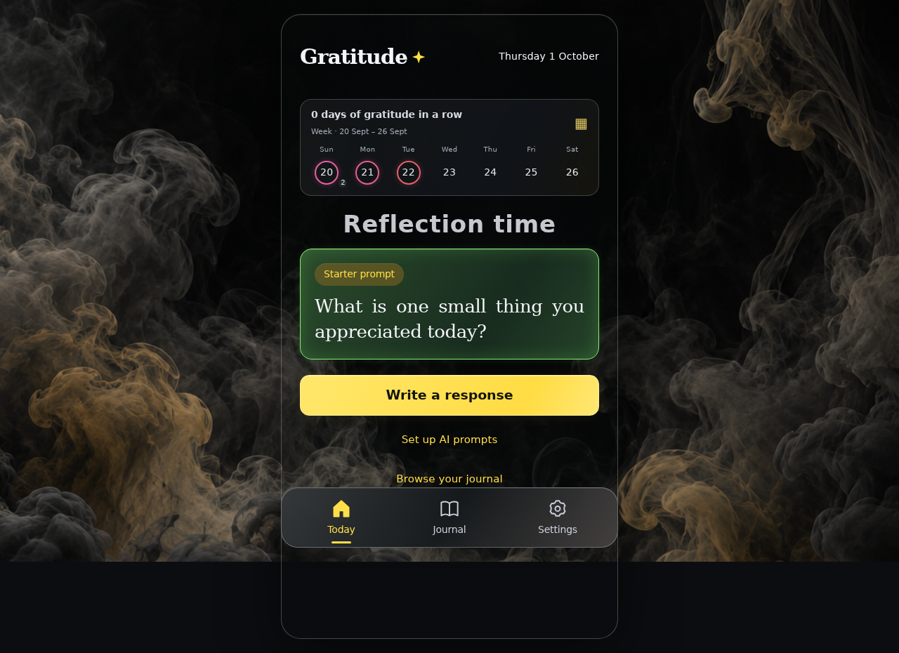
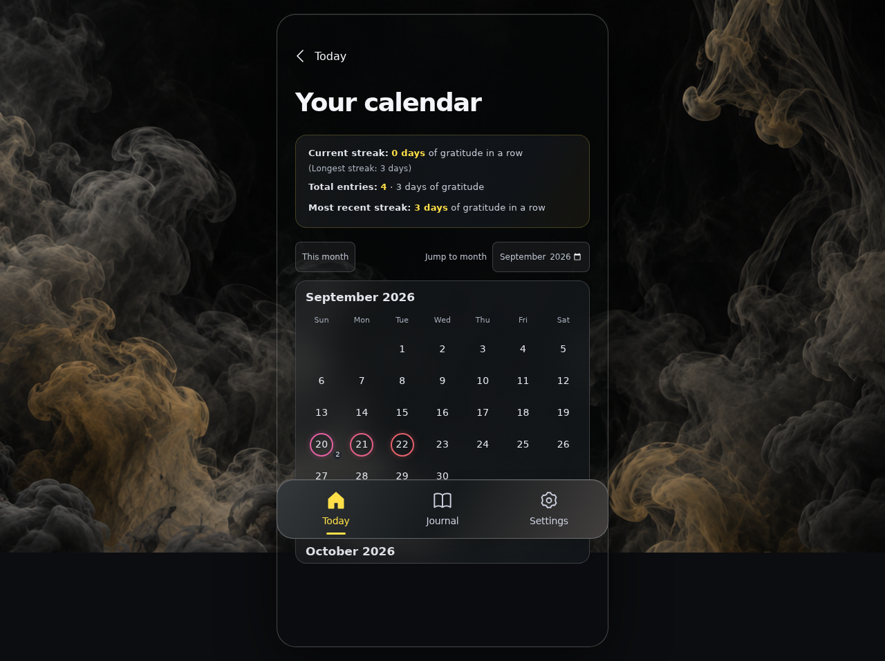
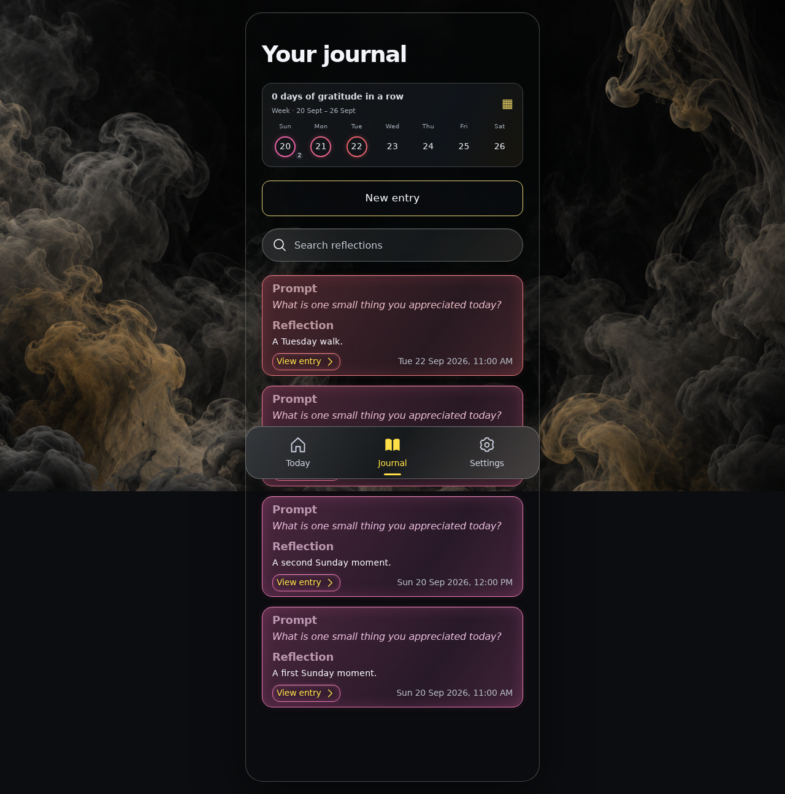

<!-- Generated by the E2E test. Do not edit by hand. -->

# Browse gratitude weeks and see your streaks

Touch swipes, mouse drags, horizontal wheel gestures and arrow keys move seven days at a time. Future dates stay disabled, taps still open every reflection on a date, and return navigation retains the week. The calendar separates current, longest and latest streaks, total entries and distinct gratitude days. Each action is followed by an unmasked full-page zero-pixel screenshot comparison.

Viewport: desktop-chromium.

## Open Gratitude

**Verifications:**

- [x] Sign-in is available and the production build preserves the frosted glass blur
- [x] Screenshot matches the committed baseline (zero differing pixels)

## Choose Google sign-in

**Verifications:**

- [x] The Google emulator account chooser opens
- [x] Screenshot matches the committed baseline (zero differing pixels)

## Add a fictional Google account

**Verifications:**

- [x] The account form opens
- [x] Screenshot matches the committed baseline (zero differing pixels)

## Enter the fictional email address

**Verifications:**

- [x] The email field retains the input
- [x] Screenshot matches the committed baseline (zero differing pixels)

## Enter a display name

**Verifications:**

- [x] The display name is entered
- [x] Screenshot matches the committed baseline (zero differing pixels)

## Complete sign-in and open Today

**Verifications:**

- [x] The private journal is synchronized and Today is ready
- [x] The bottom navigation retains its 24px backdrop blur in the production build
- [x] Screenshot matches the committed baseline (zero differing pixels)

## Swipe right to the previous Sunday-first week

**Verifications:**

- [x] One gesture moves seven days; saved rings reflect that week without opening an entry
- [x] Screenshot matches the committed baseline (zero differing pixels)

## Open all reflections on a date in the previous week

**Verifications:**

- [x] The expected result of this action is visible
- [x] Screenshot matches the committed baseline (zero differing pixels)

## Return to the same historical week

**Verifications:**

- [x] The expected result of this action is visible
- [x] Screenshot matches the committed baseline (zero differing pixels)

## Swipe left to return to this week

**Verifications:**

- [x] The expected result of this action is visible
- [x] Screenshot matches the committed baseline (zero differing pixels)

## Use one horizontal scroll gesture to visit next week

**Verifications:**

- [x] The gesture’s momentum does not skip several weeks, and all future dates stay disabled
- [x] Screenshot matches the committed baseline (zero differing pixels)

## Focus the week strip for keyboard navigation

**Verifications:**

- [x] The expected result of this action is visible
- [x] Screenshot matches the committed baseline (zero differing pixels)

## Move back exactly one week with the left arrow key

**Verifications:**

- [x] The expected result of this action is visible
- [x] Screenshot matches the committed baseline (zero differing pixels)

## Move back to the saved historical week

**Verifications:**

- [x] The expected result of this action is visible
- [x] Screenshot matches the committed baseline (zero differing pixels)

## Open the calendar at the week being browsed

**Verifications:**

- [x] A gap leaves the current streak at zero; the latest and longest stretches remain three days across four entries
- [x] Screenshot matches the committed baseline (zero differing pixels)

## Reload without losing the calendar or its historical return week

**Verifications:**

- [x] The expected result of this action is visible
- [x] Screenshot matches the committed baseline (zero differing pixels)

## Return from the calendar to the same week

**Verifications:**

- [x] The expected result of this action is visible
- [x] Screenshot matches the committed baseline (zero differing pixels)

## Keep the browsed week when switching to Journal

**Verifications:**

- [x] The expected result of this action is visible
- [x] Screenshot matches the committed baseline (zero differing pixels)

## Swipe the Journal week strip forward too

**Verifications:**

- [x] The expected result of this action is visible
- [x] Screenshot matches the committed baseline (zero differing pixels)
