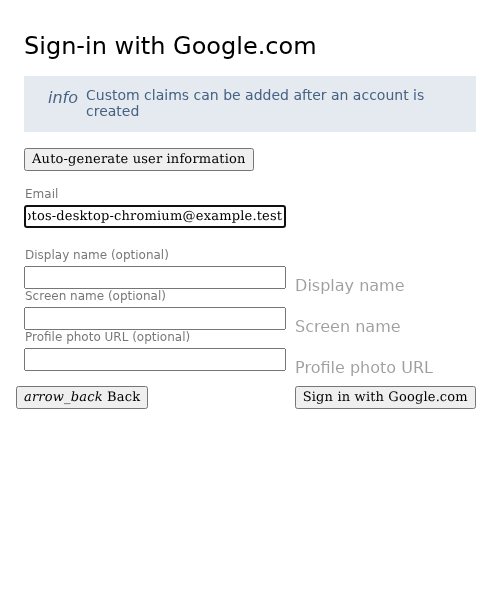
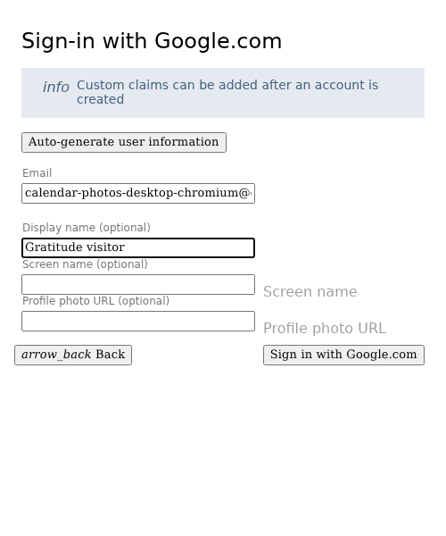
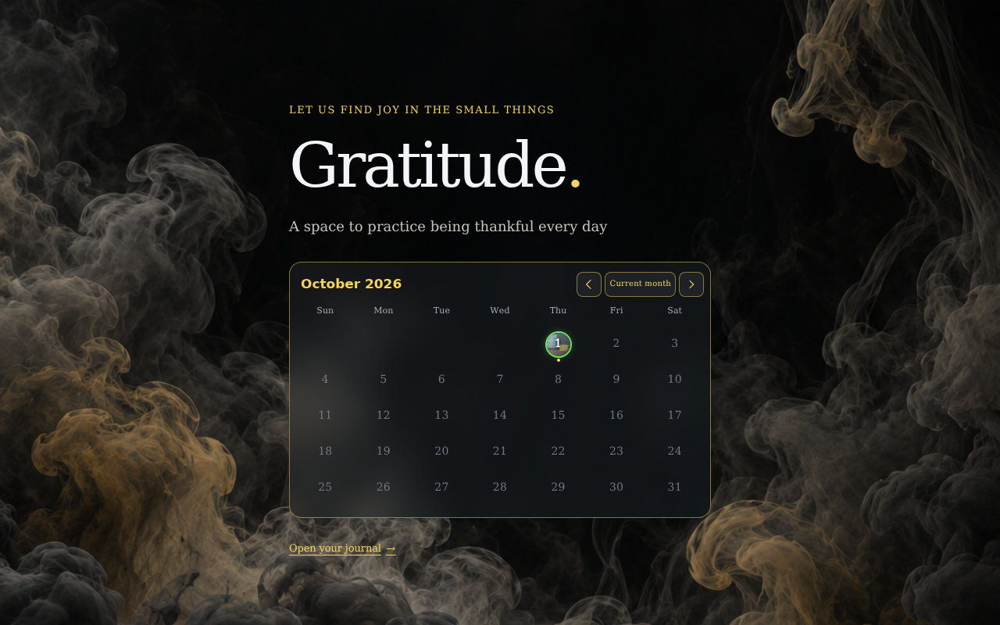
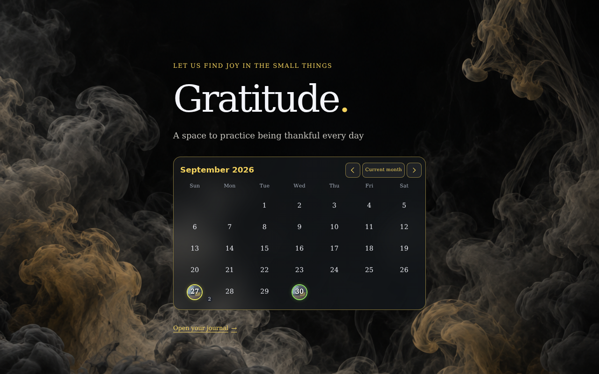
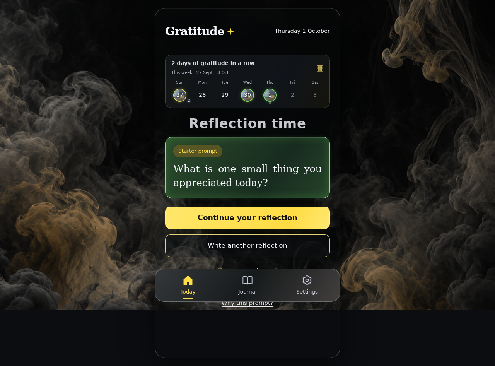
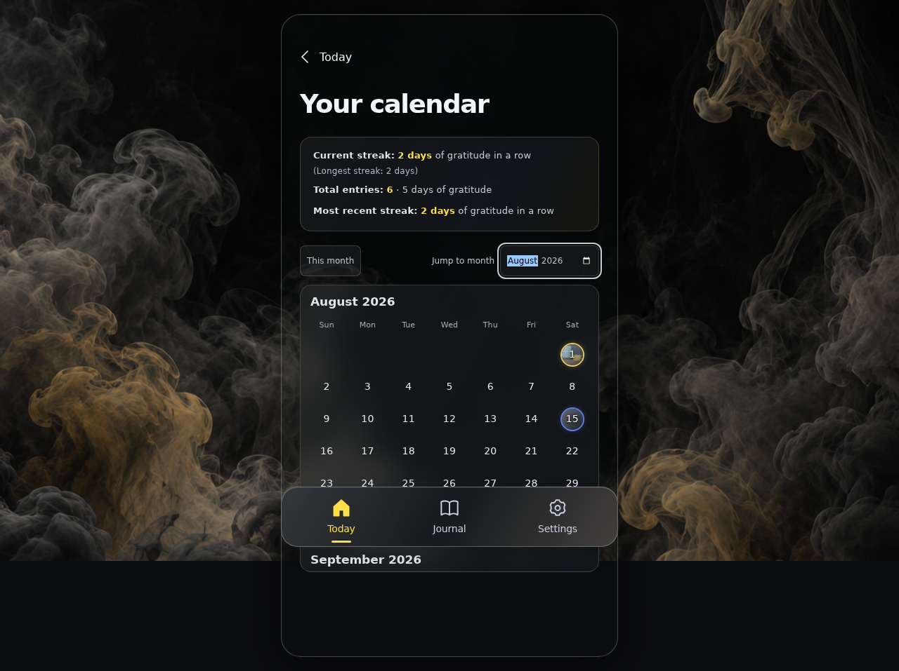
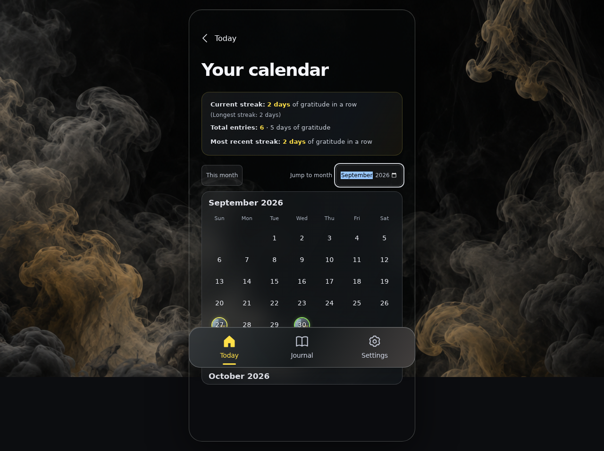
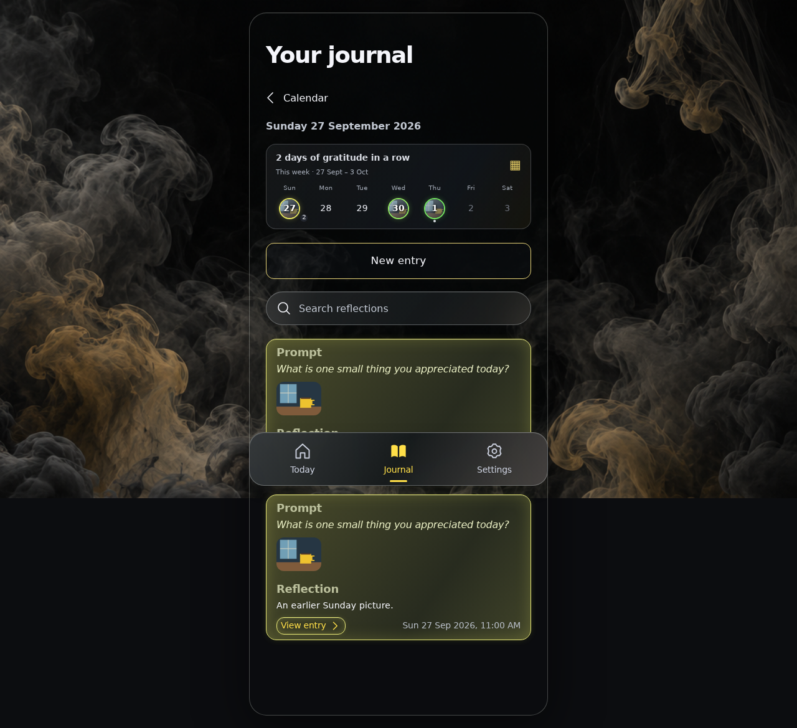
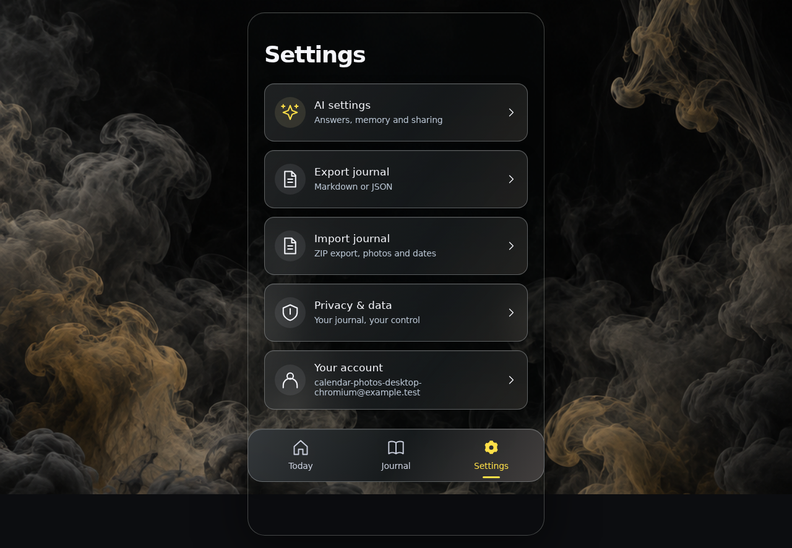
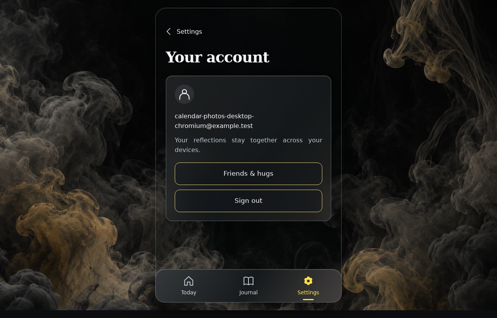

<!-- Generated by the E2E test. Do not edit by hand. -->

# Fogged photo circles in every gratitude calendar

Fictional private attachments supply date thumbnails in week strips, the landing month and the scrolling calendar. The newest dated reflection with photos supplies its first live slot. Visible photos share a bounded memory cache; offscreen months stay lazy, missing images preserve readable dates, removals and replay update the selection, and sign-out removes private previews. The lowered landing heading keeps its top anchoring. Every user action has an unmasked full-page zero-pixel screenshot with checks underneath.

Viewport: desktop-chromium.

## Open Gratitude

**Verifications:**

- [x] The shared landing page shows its empty calendar and frosted sign-in notice
- [x] Screenshot matches the committed baseline (zero differing pixels)

## Choose Google sign-in

**Verifications:**

- [x] The Google emulator account chooser opens
- [x] Screenshot matches the committed baseline (zero differing pixels)

## Add a fictional Google account

**Verifications:**

- [x] The account form opens
- [x] Screenshot matches the committed baseline (zero differing pixels)

## Enter the fictional email address

**Verifications:**

- [x] The email field retains the input
- [x] Screenshot matches the committed baseline (zero differing pixels)

## Enter a display name

**Verifications:**

- [x] The display name is entered
- [x] Screenshot matches the committed baseline (zero differing pixels)

## Complete sign-in and open Today

**Verifications:**

- [x] The private journal is synchronized and Today is ready
- [x] The bottom navigation retains its 24px backdrop blur in the production build
- [x] Screenshot matches the committed baseline (zero differing pixels)

## See fogged photo circles in the current week

**Verifications:**

- [x] Sunday, Wednesday and Today show readable numbers, date-colour rings and decoded private thumbnails
- [x] Screenshot matches the committed baseline (zero differing pixels)

## Open the lowered landing page and its photo month

**Verifications:**

- [x] The page moves down by approximately one capital G while date photos retain their coloured rings
- [x] Screenshot matches the committed baseline (zero differing pixels)

## Browse September’s photo dates

**Verifications:**

- [x] The month and week reuse the same tiny, owner-bound thumbnail without another image download
- [x] Screenshot matches the committed baseline (zero differing pixels)

## Return to the signed-in app

**Verifications:**

- [x] The expected result of this action is visible
- [x] Screenshot matches the committed baseline (zero differing pixels)

## Open photo dates in the scrolling calendar

**Verifications:**

- [x] Offscreen months do not trigger private photo downloads
- [x] Screenshot matches the committed baseline (zero differing pixels)

## Load photos when their historical month becomes visible

**Verifications:**

- [x] A visible historical photo loads; an unavailable file keeps its date readable and clickable
- [x] Screenshot matches the committed baseline (zero differing pixels)

## Return to the previously loaded photo month

**Verifications:**

- [x] The expected result of this action is visible
- [x] Screenshot matches the committed baseline (zero differing pixels)

## Reflect a photo removal from another device

**Verifications:**

- [x] Sunday selects the next occupied photo slot and the old thumbnail disappears
- [x] Screenshot matches the committed baseline (zero differing pixels)

## Recreate photo date selections from cached and source state

**Verifications:**

- [x] The expected result of this action is visible
- [x] Screenshot matches the committed baseline (zero differing pixels)

## Keep the usual date-click behaviour for a photo date

**Verifications:**

- [x] The expected result of this action is visible
- [x] Screenshot matches the committed baseline (zero differing pixels)

## Open Settings

**Verifications:**

- [x] The expected result of this action is visible
- [x] Screenshot matches the committed baseline (zero differing pixels)

## Open account controls

**Verifications:**

- [x] The expected result of this action is visible
- [x] Screenshot matches the committed baseline (zero differing pixels)

## End the owner’s photo session

**Verifications:**

- [x] The expected result of this action is visible
- [x] Screenshot matches the committed baseline (zero differing pixels)

## Keep the signed-out preview free of private images

**Verifications:**

- [x] The expected result of this action is visible
- [x] Screenshot matches the committed baseline (zero differing pixels)
