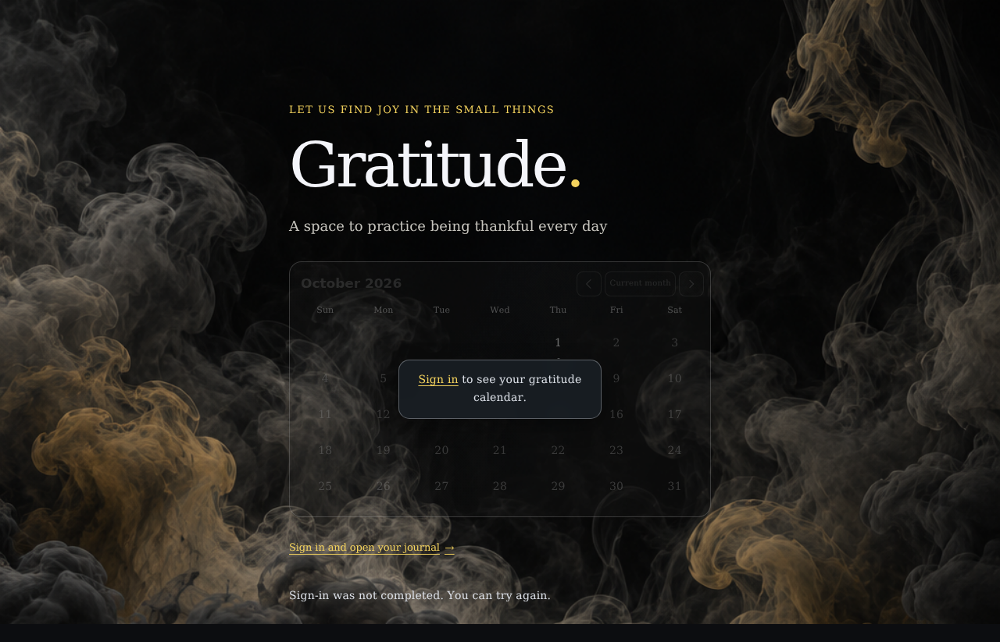
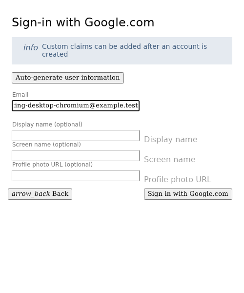
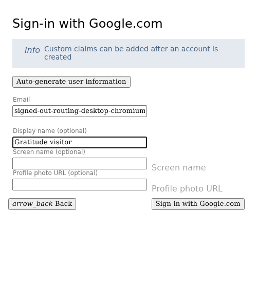
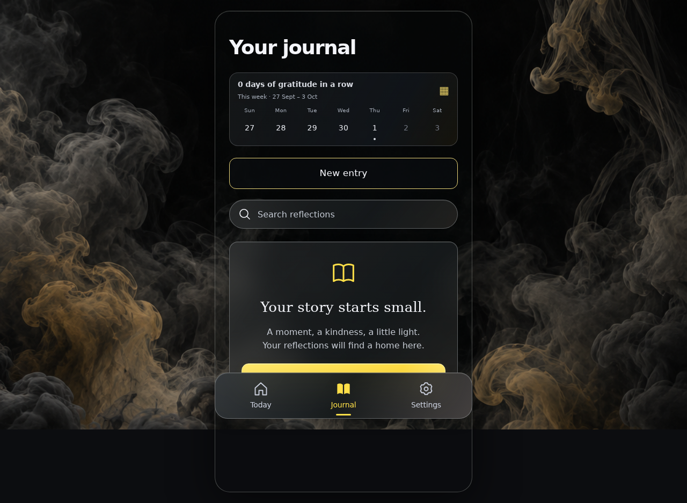
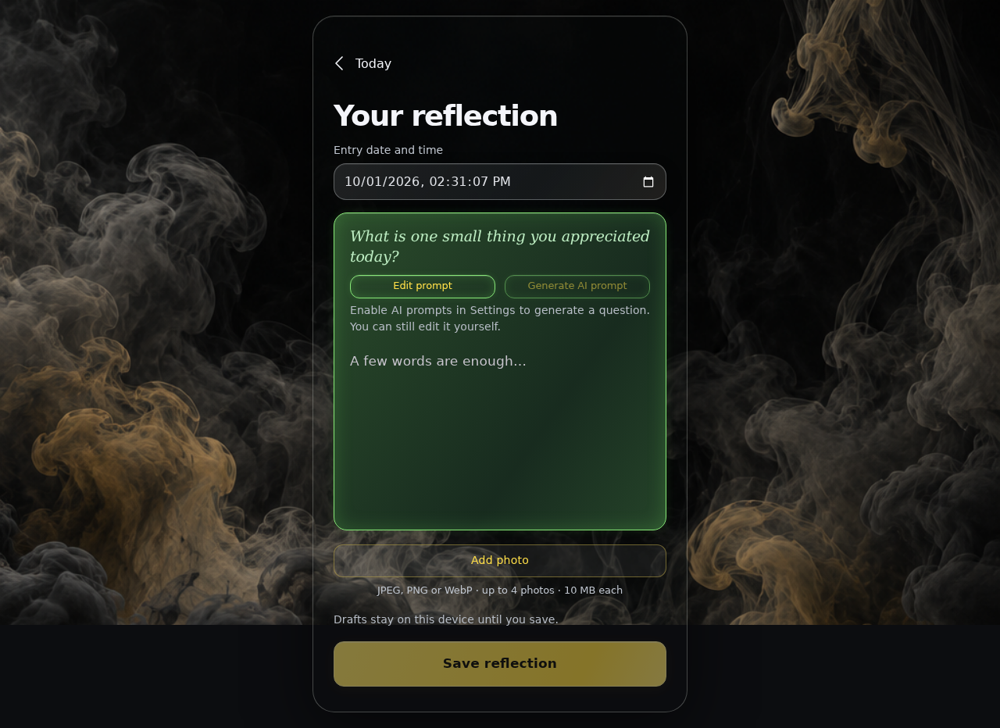
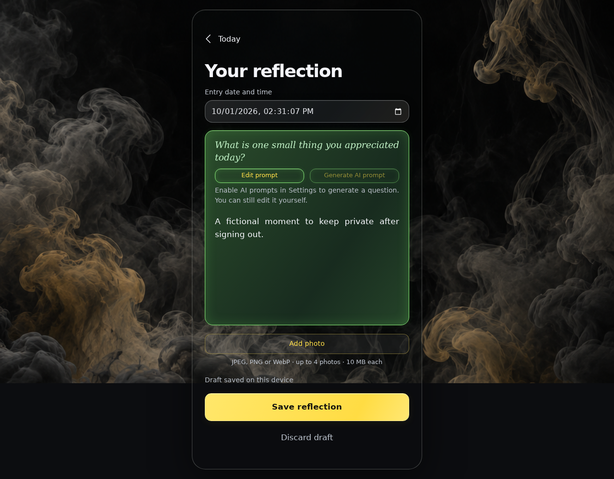
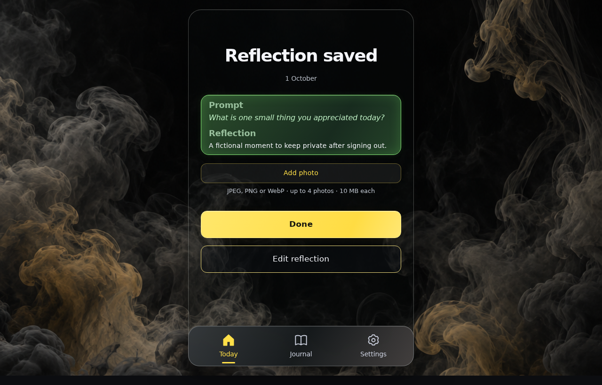
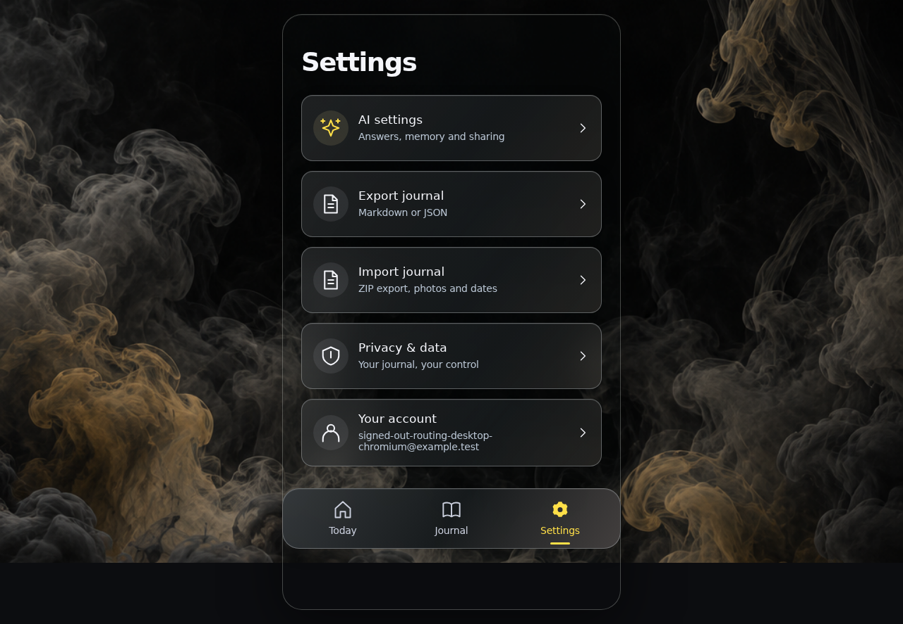
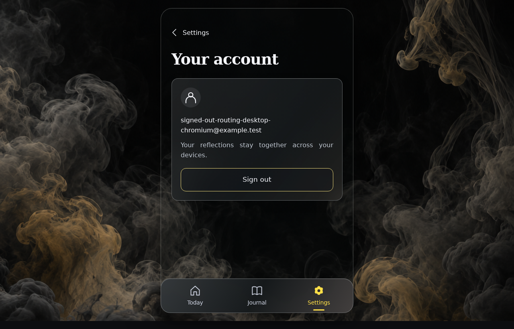

<!-- Generated by the E2E test. Do not edit by hand. -->

# One landing page before sign-in

Root, Journal, Settings and Journal sign-in links show the same greyed-out empty calendar before authentication. Cancelling Google sign-in keeps that page and allows retry; the footer opens Journal after sign-in. A restored session opens Settings directly, and sign-out removes private content immediately. Every action has an unmasked screenshot comparison with zero differing pixels, with checks below the image.

Viewport: desktop-chromium.

## Open ./ before signing in

**Verifications:**

- [x] The same empty, disabled calendar and landing text appear without private content
- [x] Screenshot matches the committed baseline (zero differing pixels)

## Open ./journal/ before signing in

**Verifications:**

- [x] The same empty, disabled calendar and landing text appear without private content
- [x] Screenshot matches the committed baseline (zero differing pixels)

## Open ./settings/ before signing in

**Verifications:**

- [x] The same empty, disabled calendar and landing text appear without private content
- [x] Screenshot matches the committed baseline (zero differing pixels)

## Open ./journal/?afterSignIn=journal before signing in

**Verifications:**

- [x] The same empty, disabled calendar and landing text appear without private content
- [x] Screenshot matches the committed baseline (zero differing pixels)

## Reload the Journal sign-in link without signing in

**Verifications:**

- [x] The expected result of this action is visible
- [x] Screenshot matches the committed baseline (zero differing pixels)

## Open Google authentication from the landing calendar

**Verifications:**

- [x] The Google account chooser opens directly
- [x] Screenshot matches the committed baseline (zero differing pixels)

## Close authentication without signing in

**Verifications:**

- [x] The expected result of this action is visible
- [x] Screenshot matches the committed baseline (zero differing pixels)

## Choose Google sign-in

**Verifications:**

- [x] The Google emulator account chooser opens
- [x] Screenshot matches the committed baseline (zero differing pixels)

## Add a fictional Google account

**Verifications:**

- [x] The account form opens
- [x] Screenshot matches the committed baseline (zero differing pixels)

## Enter the fictional email address

**Verifications:**

- [x] The email field retains the input
- [x] Screenshot matches the committed baseline (zero differing pixels)

## Enter a display name

**Verifications:**

- [x] The display name is entered
- [x] Screenshot matches the committed baseline (zero differing pixels)

## Open Journal after sign-in from the landing page

**Verifications:**

- [x] The landing sign-in link opens the synchronized Journal
- [x] The bottom navigation retains its 24px backdrop blur in the production build
- [x] Screenshot matches the committed baseline (zero differing pixels)

## Open Today

**Verifications:**

- [x] The expected result of this action is visible
- [x] Screenshot matches the committed baseline (zero differing pixels)

## Open the reflection editor

**Verifications:**

- [x] The expected result of this action is visible
- [x] Screenshot matches the committed baseline (zero differing pixels)

## Write a reflection

**Verifications:**

- [x] The expected result of this action is visible
- [x] Screenshot matches the committed baseline (zero differing pixels)

## Save the reflection

**Verifications:**

- [x] The expected result of this action is visible
- [x] Screenshot matches the committed baseline (zero differing pixels)

## Open Settings directly with a restored account session

**Verifications:**

- [x] The expected result of this action is visible
- [x] Screenshot matches the committed baseline (zero differing pixels)

## Open account settings

**Verifications:**

- [x] The expected result of this action is visible
- [x] Screenshot matches the committed baseline (zero differing pixels)

## Sign out directly onto the public landing calendar

**Verifications:**

- [x] The expected result of this action is visible
- [x] Screenshot matches the committed baseline (zero differing pixels)

## Keep the public landing on a signed-out Settings reload

**Verifications:**

- [x] The expected result of this action is visible
- [x] Screenshot matches the committed baseline (zero differing pixels)
