<!-- Generated by the E2E test. Do not edit by hand. -->

# Your favourite accent colour

Account accents use the fourteen supplied hex points independently of the date rainbow, sync independently of AI consent, light the smoke and recolour the glass, and preserve reflection date colours. The picker uses the exact supplied hex points; the smoke keeps its neutral texture with a subdued lighting hue from the selected point; icons use their strongest readable tint, with matching wordmark-star colour and the same border opacity. AI guidance grows with its content and states its 500-character limit.

Viewport: mobile-chromium.

## Open Gratitude

**Verifications:**

- [x] The shared landing page shows its empty calendar and frosted sign-in notice
- [x] Screenshot matches the committed baseline (zero differing pixels)

## Choose Google sign-in

**Verifications:**

- [x] The Google emulator account chooser opens
- [x] Screenshot matches the committed baseline (zero differing pixels)

## Add a fictional Google account

**Verifications:**

- [x] The account form opens
- [x] Screenshot matches the committed baseline (zero differing pixels)

## Enter the fictional email address

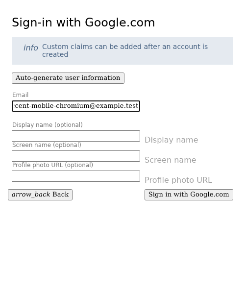

**Verifications:**

- [x] The email field retains the input
- [x] Screenshot matches the committed baseline (zero differing pixels)

## Enter a display name

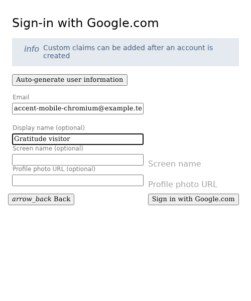

**Verifications:**

- [x] The display name is entered
- [x] Screenshot matches the committed baseline (zero differing pixels)

## Review the optional next-visit onboarding

**Verifications:**

- [x] The welcome offers optional setup without enabling AI or sharing
- [x] Screenshot matches the committed baseline (zero differing pixels)

## Keep existing settings and skip optional onboarding

**Verifications:**

- [x] The expected result of this action is visible
- [x] Screenshot matches the committed baseline (zero differing pixels)

## Complete sign-in and open Today

**Verifications:**

- [x] The private journal is synchronized and Today is ready
- [x] The bottom navigation retains its 24px backdrop blur in the production build
- [x] Screenshot matches the committed baseline (zero differing pixels)

## Open the reflection editor

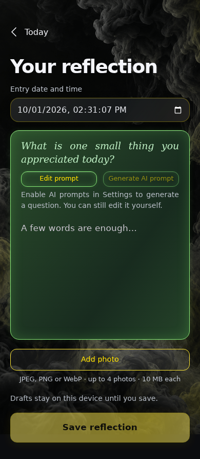

**Verifications:**

- [x] The expected result of this action is visible
- [x] Screenshot matches the committed baseline (zero differing pixels)

## Write a reflection

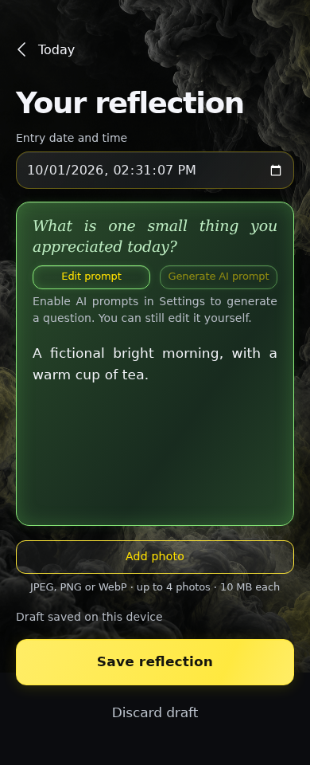

**Verifications:**

- [x] The expected result of this action is visible
- [x] Screenshot matches the committed baseline (zero differing pixels)

## Save the reflection

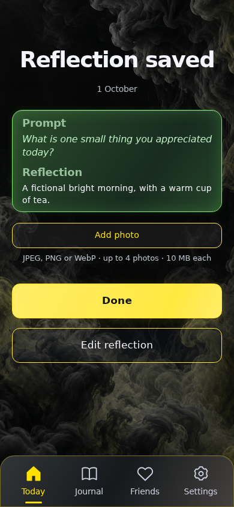

**Verifications:**

- [x] The expected result of this action is visible
- [x] Screenshot matches the committed baseline (zero differing pixels)

## Open Settings

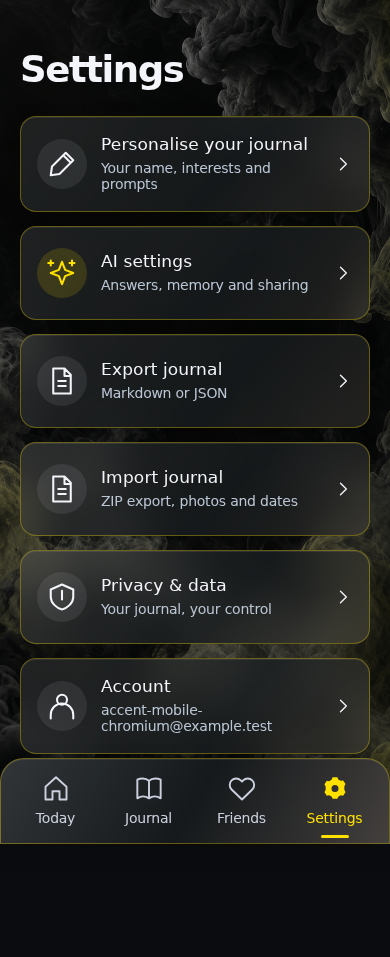

**Verifications:**

- [x] The expected result of this action is visible
- [x] Screenshot matches the committed baseline (zero differing pixels)

## Open Account and its fourteen rainbow accent choices

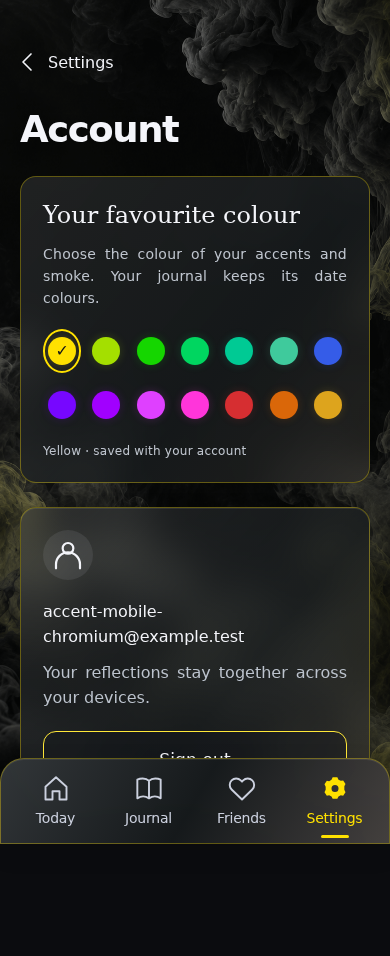

**Verifications:**

- [x] The expected result of this action is visible
- [x] Screenshot matches the committed baseline (zero differing pixels)

## Choose lime accents and smoke

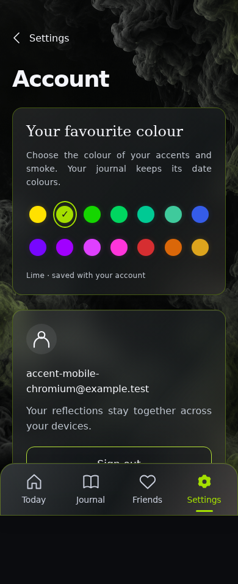

**Verifications:**

- [x] The selected icon and underline keep the swatch hue and strong colour; the glass border retains its original colour and opacity
- [x] Screenshot matches the committed baseline (zero differing pixels)

## Choose green accents and smoke

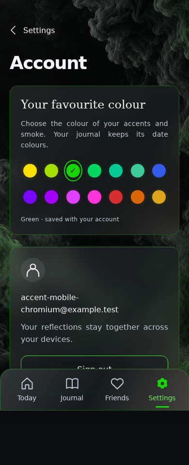

**Verifications:**

- [x] The selected icon and underline keep the swatch hue and strong colour; the glass border retains its original colour and opacity
- [x] Screenshot matches the committed baseline (zero differing pixels)

## Choose sea green accents and smoke

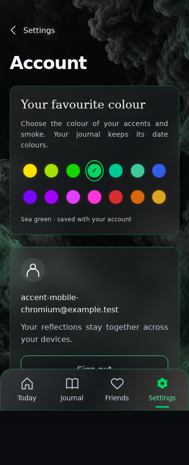

**Verifications:**

- [x] The selected icon and underline keep the swatch hue and strong colour; the glass border retains its original colour and opacity
- [x] Screenshot matches the committed baseline (zero differing pixels)

## Choose turquoise accents and smoke

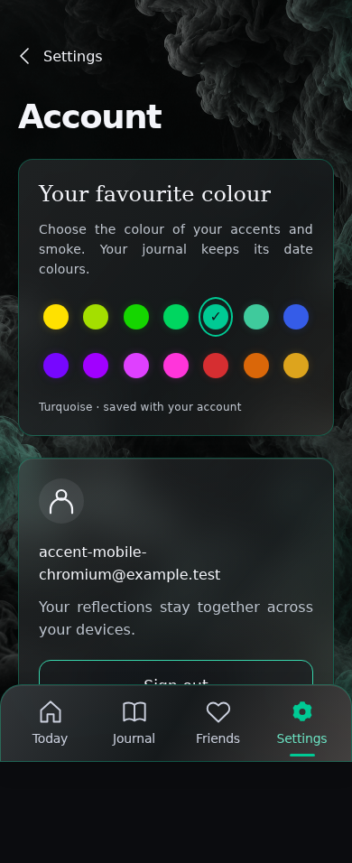

**Verifications:**

- [x] The selected icon and underline keep the swatch hue and strong colour; the glass border retains its original colour and opacity
- [x] Screenshot matches the committed baseline (zero differing pixels)

## Choose teal accents and smoke

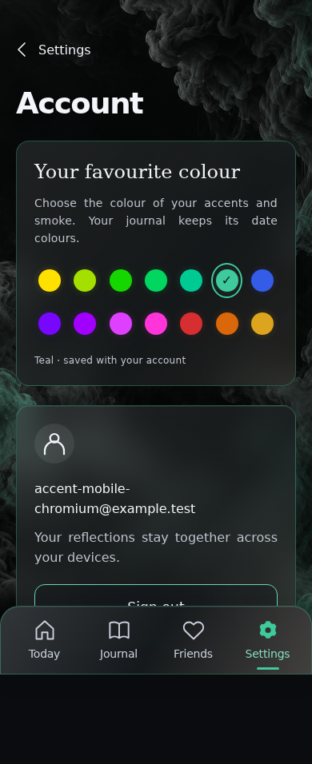

**Verifications:**

- [x] The selected icon and underline keep the swatch hue and strong colour; the glass border retains its original colour and opacity
- [x] Screenshot matches the committed baseline (zero differing pixels)

## Choose blue accents and smoke

**Verifications:**

- [x] The selected icon and underline keep the swatch hue and strong colour; the glass border retains its original colour and opacity
- [x] Screenshot matches the committed baseline (zero differing pixels)

## Choose violet accents and smoke

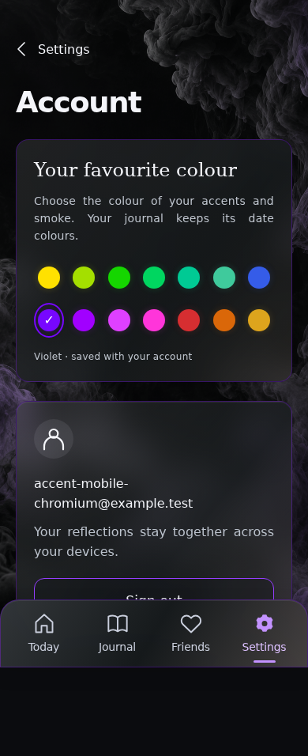

**Verifications:**

- [x] The selected icon and underline keep the swatch hue and strong colour; the glass border retains its original colour and opacity
- [x] Screenshot matches the committed baseline (zero differing pixels)

## Choose purple accents and smoke

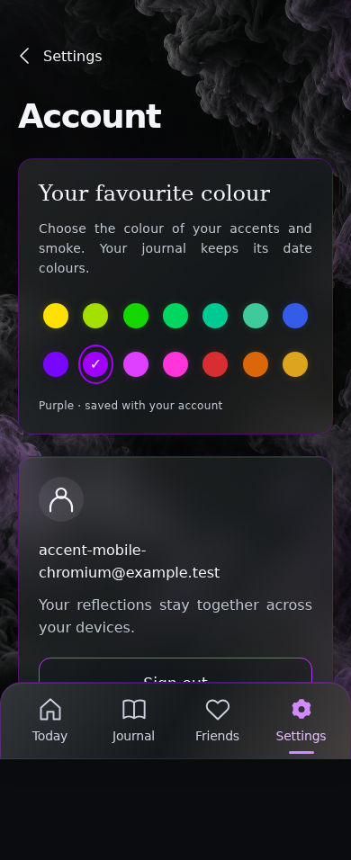

**Verifications:**

- [x] The selected icon and underline keep the swatch hue and strong colour; the glass border retains its original colour and opacity
- [x] Screenshot matches the committed baseline (zero differing pixels)

## Choose magenta accents and smoke

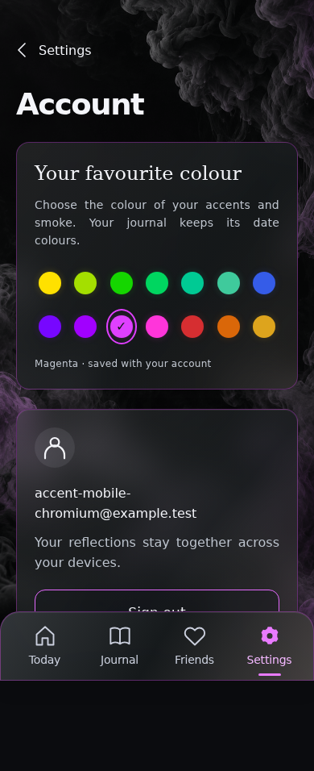

**Verifications:**

- [x] The selected icon and underline keep the swatch hue and strong colour; the glass border retains its original colour and opacity
- [x] Screenshot matches the committed baseline (zero differing pixels)

## Choose pink accents and smoke

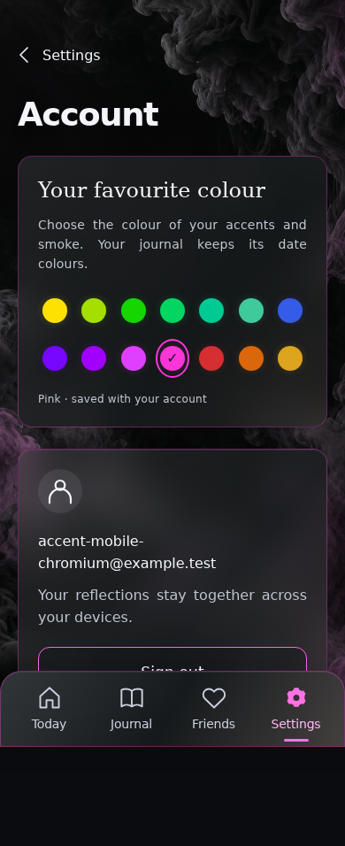

**Verifications:**

- [x] The selected icon and underline keep the swatch hue and strong colour; the glass border retains its original colour and opacity
- [x] Screenshot matches the committed baseline (zero differing pixels)

## Choose red accents and smoke

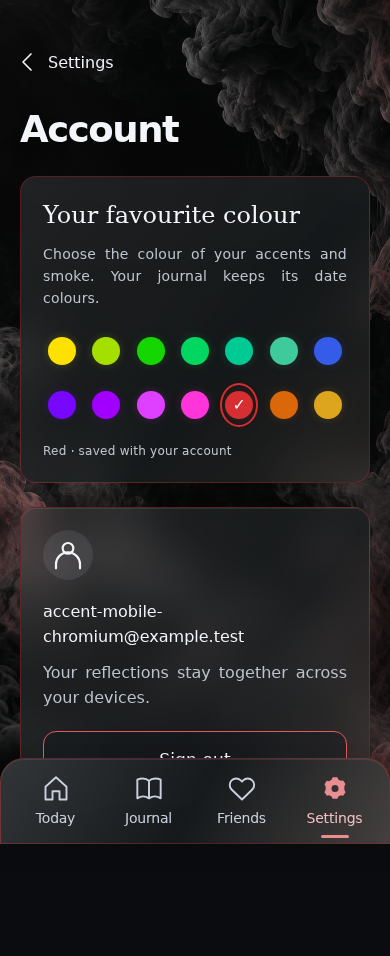

**Verifications:**

- [x] The selected icon and underline keep the swatch hue and strong colour; the glass border retains its original colour and opacity
- [x] Screenshot matches the committed baseline (zero differing pixels)

## Choose orange accents and smoke

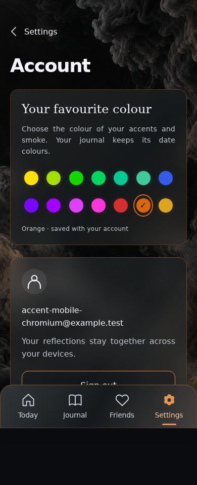

**Verifications:**

- [x] The selected icon and underline keep the swatch hue and strong colour; the glass border retains its original colour and opacity
- [x] Screenshot matches the committed baseline (zero differing pixels)

## Choose gold accents and smoke

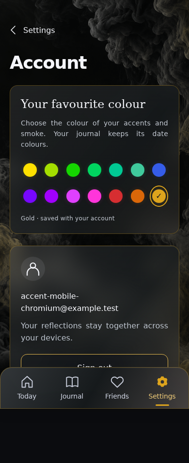

**Verifications:**

- [x] The selected icon and underline keep the swatch hue and strong colour; the glass border retains its original colour and opacity
- [x] Screenshot matches the committed baseline (zero differing pixels)

## Use blue for the following screens

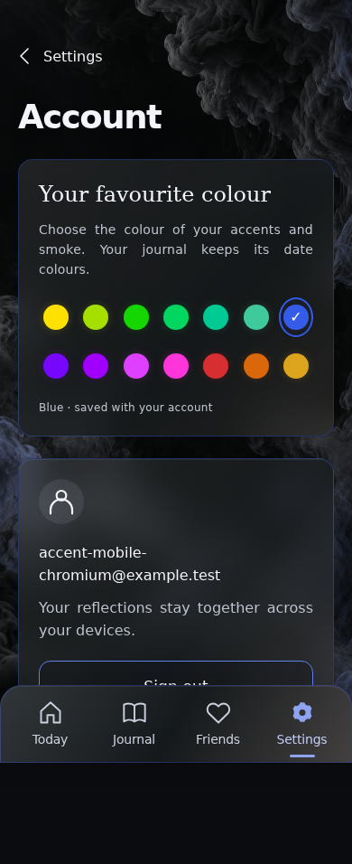

**Verifications:**

- [x] The expected result of this action is visible
- [x] Screenshot matches the committed baseline (zero differing pixels)

## Restore the account accent after reload

**Verifications:**

- [x] The expected result of this action is visible
- [x] Screenshot matches the committed baseline (zero differing pixels)

## Open Journal

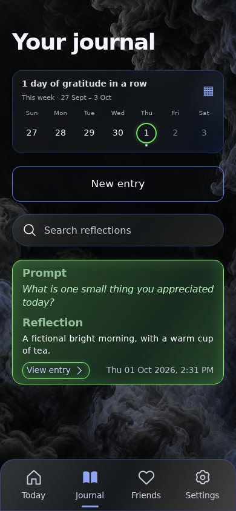

**Verifications:**

- [x] The expected result of this action is visible
- [x] Screenshot matches the committed baseline (zero differing pixels)

## Keep the reflection’s date colour under the blue theme

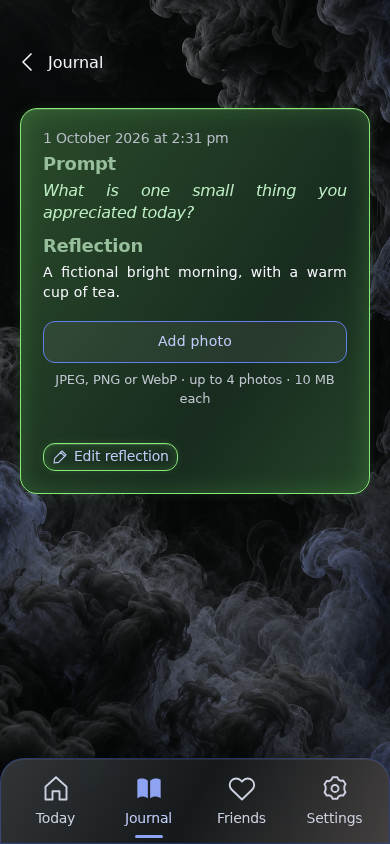

**Verifications:**

- [x] The expected result of this action is visible
- [x] Screenshot matches the committed baseline (zero differing pixels)

## Open Today with a vivid blue star and matching selected icon

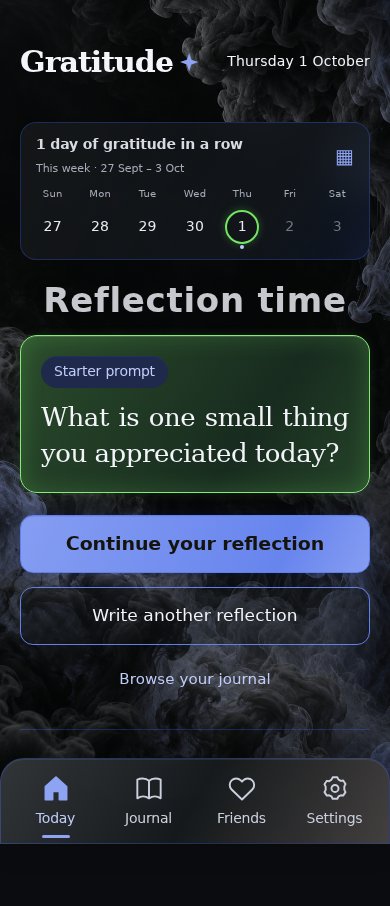

**Verifications:**

- [x] The wordmark star and selected Today icon share the stronger blue highlight
- [x] Screenshot matches the committed baseline (zero differing pixels)

## Use blue calendar controls while keeping the saved date’s rainbow ring

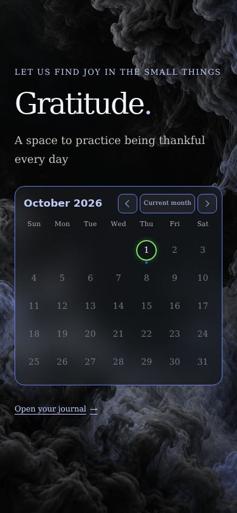

**Verifications:**

- [x] The expected result of this action is visible
- [x] Screenshot matches the committed baseline (zero differing pixels)

## Return to the themed app from the landing page

**Verifications:**

- [x] The expected result of this action is visible
- [x] Screenshot matches the committed baseline (zero differing pixels)

## Open Settings

**Verifications:**

- [x] The expected result of this action is visible
- [x] Screenshot matches the committed baseline (zero differing pixels)

## Open AI sharing choices

**Verifications:**

- [x] The expected result of this action is visible
- [x] Screenshot matches the committed baseline (zero differing pixels)

## Expand the explanation of prompt personalisation

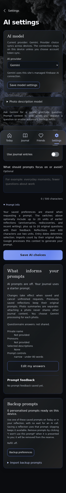

**Verifications:**

- [x] The expected result of this action is visible
- [x] Screenshot matches the committed baseline (zero differing pixels)

## Keep the optional explanation tucked away

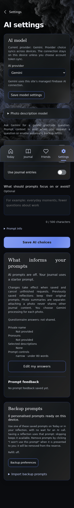

**Verifications:**

- [x] The expected result of this action is visible
- [x] Screenshot matches the committed baseline (zero differing pixels)

## Grow the field so all 500 characters remain visible

**Verifications:**

- [x] The expected result of this action is visible
- [x] Screenshot matches the committed baseline (zero differing pixels)

## Prevent typing beyond the stated character limit

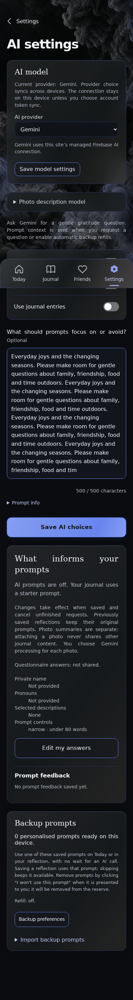

**Verifications:**

- [x] The expected result of this action is visible
- [x] Screenshot matches the committed baseline (zero differing pixels)

## Save these explicit sharing choices

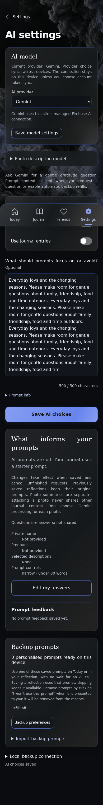

**Verifications:**

- [x] The expected result of this action is visible
- [x] Screenshot matches the committed baseline (zero differing pixels)

## Shrink the field when the guidance becomes shorter

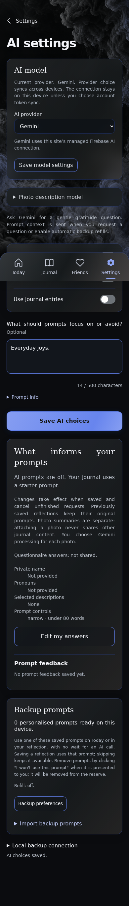

**Verifications:**

- [x] The expected result of this action is visible
- [x] Screenshot matches the committed baseline (zero differing pixels)

## Save these explicit sharing choices

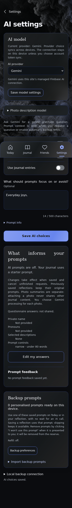

**Verifications:**

- [x] The expected result of this action is visible
- [x] Screenshot matches the committed baseline (zero differing pixels)

## Open Gratitude on a fresh device with default yellow

**Verifications:**

- [x] The expected result of this action is visible
- [x] Screenshot matches the committed baseline (zero differing pixels)

## Choose Google sign-in

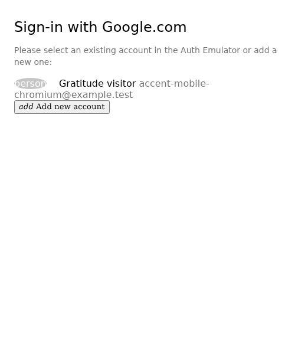

**Verifications:**

- [x] The Google emulator account chooser opens
- [x] Screenshot matches the committed baseline (zero differing pixels)

## Return to the journal after today’s saved reflection

**Verifications:**

- [x] The saved daily reflection makes Journal the initial page on this device
- [x] The bottom navigation retains its 24px backdrop blur in the production build
- [x] Screenshot matches the committed baseline (zero differing pixels)

## Restore blue from the account’s event stream

**Verifications:**

- [x] A new device receives the chosen colour through full replay
- [x] Screenshot matches the committed baseline (zero differing pixels)

## Open Settings

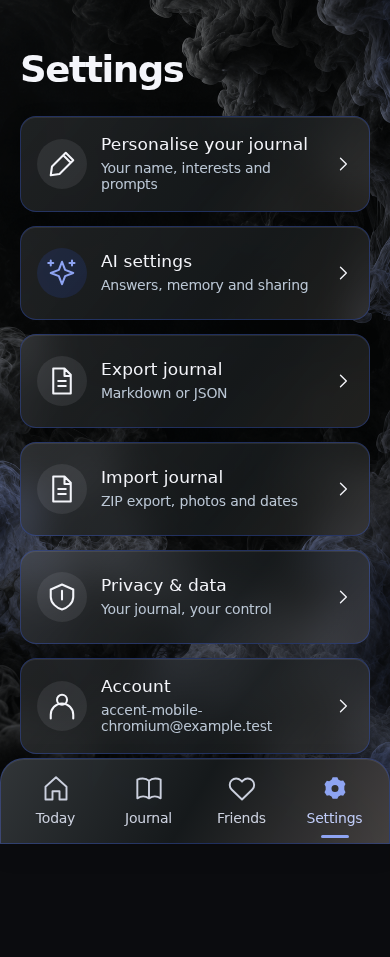

**Verifications:**

- [x] The expected result of this action is visible
- [x] Screenshot matches the committed baseline (zero differing pixels)

## Open AI sharing choices

**Verifications:**

- [x] The expected result of this action is visible
- [x] Screenshot matches the committed baseline (zero differing pixels)

## Restore the saved short guidance and its character count

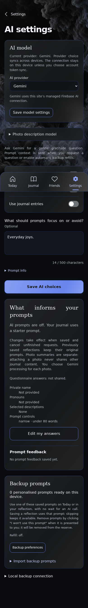

**Verifications:**

- [x] The field and explicit limit agree on both devices
- [x] Screenshot matches the committed baseline (zero differing pixels)

## Open Settings

**Verifications:**

- [x] The expected result of this action is visible
- [x] Screenshot matches the committed baseline (zero differing pixels)

## Return to Account

**Verifications:**

- [x] The expected result of this action is visible
- [x] Screenshot matches the committed baseline (zero differing pixels)

## Return public pages to yellow on sign-out

**Verifications:**

- [x] The expected result of this action is visible
- [x] Screenshot matches the committed baseline (zero differing pixels)
