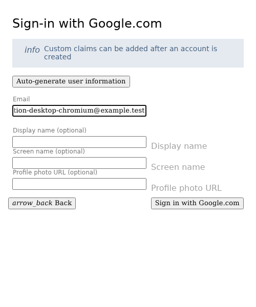
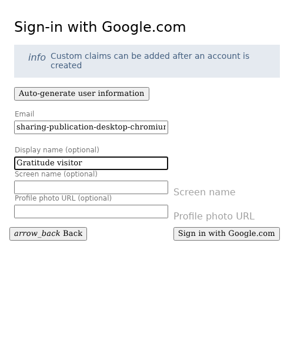
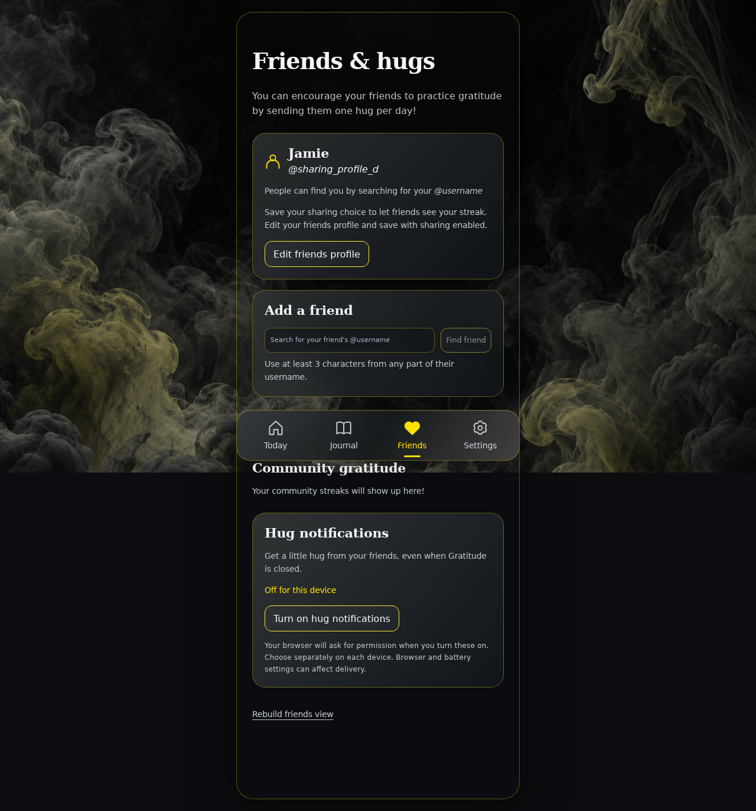
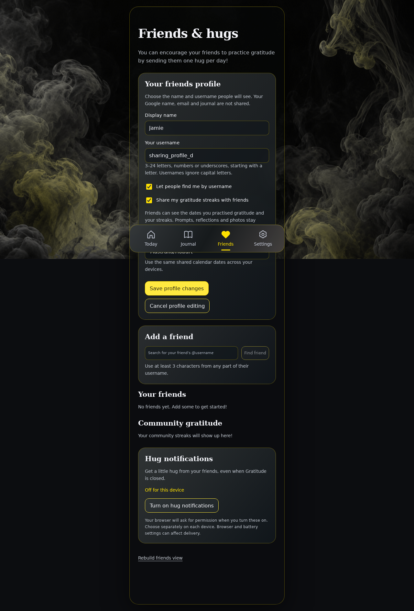
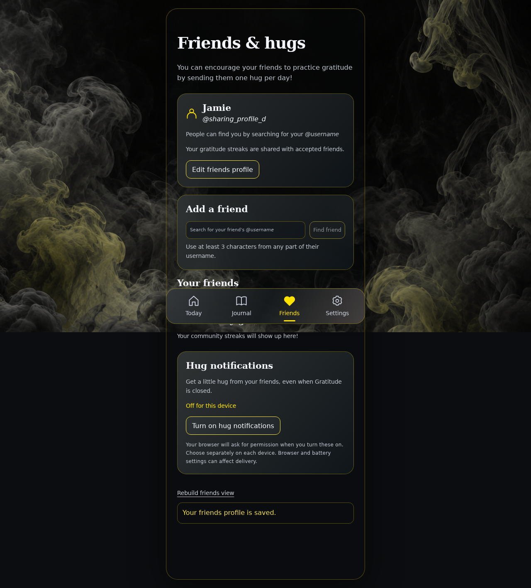
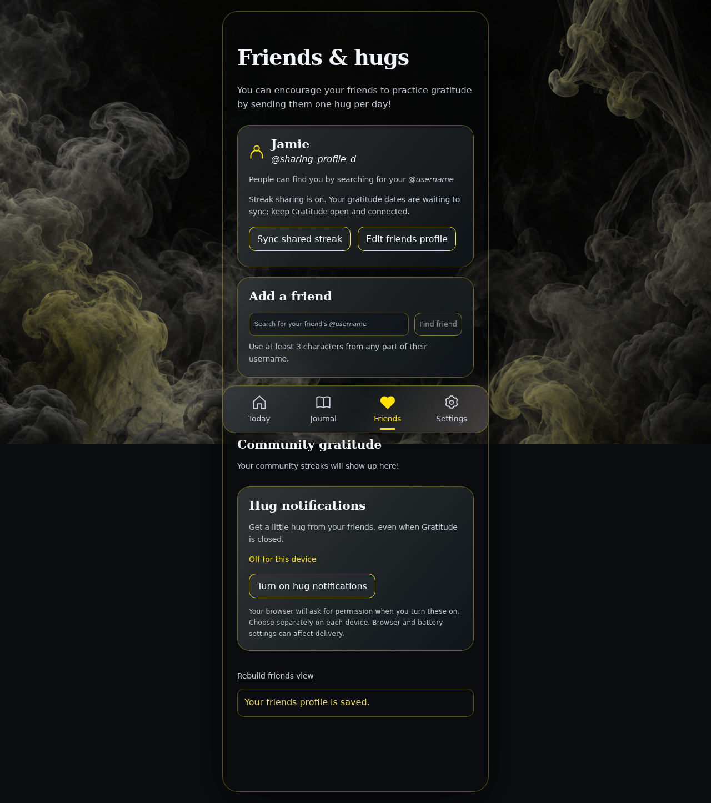

<!-- Generated by the E2E test. Do not edit by hand. -->

# Make streak sharing explicit and repairable

An existing profile without a sharing source record is not described as shared. A preselected checkbox is only a draft until Save. Confirmed publication exposes only the expected dates; a missing disposable calendar has a repair button that preserves consent and journal data. Every action has an unmasked zero-tolerance screenshot and checks underneath it.

Viewport: desktop-chromium.

## Open Gratitude

**Verifications:**

- [x] The shared landing page shows its empty calendar and frosted sign-in notice
- [x] Screenshot matches the committed baseline (zero differing pixels)

## Choose Google sign-in

**Verifications:**

- [x] The Google emulator account chooser opens
- [x] Screenshot matches the committed baseline (zero differing pixels)

## Add a fictional Google account

**Verifications:**

- [x] The account form opens
- [x] Screenshot matches the committed baseline (zero differing pixels)

## Enter the fictional email address

**Verifications:**

- [x] The email field retains the input
- [x] Screenshot matches the committed baseline (zero differing pixels)

## Enter a display name

**Verifications:**

- [x] The display name is entered
- [x] Screenshot matches the committed baseline (zero differing pixels)

## Review the optional next-visit onboarding

**Verifications:**

- [x] The welcome offers optional setup without enabling AI or sharing
- [x] Screenshot matches the committed baseline (zero differing pixels)

## Keep existing settings and skip optional onboarding

**Verifications:**

- [x] The expected result of this action is visible
- [x] Screenshot matches the committed baseline (zero differing pixels)

## Complete sign-in and open Today

**Verifications:**

- [x] The private journal is synchronized and Today is ready
- [x] The bottom navigation retains its 24px backdrop blur in the production build
- [x] Screenshot matches the committed baseline (zero differing pixels)

## Open Friends and hugs

**Verifications:**

- [x] The expected result of this action is visible
- [x] Screenshot matches the committed baseline (zero differing pixels)

## Show that a profile alone does not publish gratitude dates

**Verifications:**

- [x] The owner sees an explicit instruction to save sharing, and no sharing source action or public calendar exists
- [x] Screenshot matches the committed baseline (zero differing pixels)

## Open the existing friends profile

**Verifications:**

- [x] The expected result of this action is visible
- [x] Screenshot matches the committed baseline (zero differing pixels)

## Explicitly save sharing and publish the known reflection date

**Verifications:**

- [x] The expected result of this action is visible
- [x] Screenshot matches the committed baseline (zero differing pixels)

## Distinguish saved consent from a calendar awaiting publication

**Verifications:**

- [x] The owner sees that dates need syncing and gets an explicit repair action
- [x] Screenshot matches the committed baseline (zero differing pixels)

## Rebuild only the public date projection from the loaded journal

**Verifications:**

- [x] The expected result of this action is visible
- [x] Screenshot matches the committed baseline (zero differing pixels)
